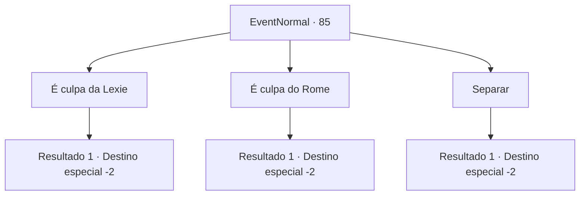

# Eventos normais · 85

[Índice da tabela](index.md) · [Índice geral](../index.md)

ID: `pt:EventNormal:85` · Fonte: `EventNormal4` · Versão: 1.2.47.

Mapeamento estático dos arquivos; a disponibilidade e a execução dependem do estado da run.

## Texto do evento

*Sem texto no arquivo.*

## Dados de entrada

```json
{
  "id": 85,
  "grade": 1,
  "place": "",
  "required": ""
}
```

## Mapa das escolhas



## Escolhas e resultados

### Escolha 1

É culpa da Lexie

Requisitos e outros campos da escolha:

```json
{
  "required": ""
}
```

#### Resultado 1.1

Você aponta o que Lexie fez de errado. Você não acredita em amigos entre homens e mulheres. Não importa o que. O híbrido humano-vampiro chamado Rome concorda com a cabeça. 

 "Obviamente. Qualquer um diria o mesmo."

 Ele exige um pedido de desculpas de Lexie, e ela foge enquanto cora. Rome agradece e vai atrás dela.

Continuação registrada: [Destino especial `-2`](../destinos-especiais.md).

```json
{
  "required": "",
  "chance": "1",
  "nextEvent": -2,
  "type": 2,
  "reward": "0_2_1|5_47_2"
}
```

### Escolha 2

É culpa do Rome

Requisitos e outros campos da escolha:

```json
{
  "required": ""
}
```

#### Resultado 2.1

Você aponta o que Rome fez de errado. Você diz a ele para ser homem e parar de ser tão mesquinho. Lexie concorda com a cabeça. 

 "Sou o mais inocente possível, Rome!"

 Ela exige um pedido de desculpas do vampiro. Hesitante, ele murmura um pedido de desculpas. Lexie agradece e lhe entrega um pouco de ouro. 

 "Ele é apenas um amigo, ok? Eu não tenho ninguém além de você, querido."

 Eles saem de braços dados, como se nunca tivessem brigado.

Continuação registrada: [Destino especial `-2`](../destinos-especiais.md).

```json
{
  "required": "",
  "chance": "1",
  "nextEvent": -2,
  "type": 2,
  "reward": "0_2_1|0_4_10|5_47_2"
}
```

### Escolha 3

Separar

Requisitos e outros campos da escolha:

```json
{
  "required": ""
}
```

#### Resultado 3.1

Você aponta o que cada um deles fez de errado e os aconselha a terminar. Eles gritam com você com os rostos vermelhos e saem de braços dados, como se nunca tivessem brigado.

Continuação registrada: [Destino especial `-2`](../destinos-especiais.md).

```json
{
  "required": "",
  "chance": "1",
  "nextEvent": -2,
  "type": 2,
  "reward": "0_2_1|0_3_1|5_47_3"
}
```

## Referências que chegam a este evento

- [Evento 83 · escolha 2 · resultado 1](0083.md#escolha-2)
