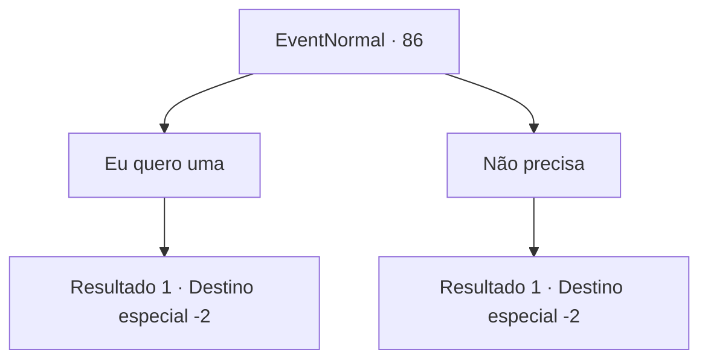

# Eventos normais · 86

[Índice da tabela](index.md) · [Índice geral](../index.md)

ID: `pt:EventNormal:86` · Fonte: `EventNormal4` · Versão: 1.2.47.

Mapeamento estático dos arquivos; a disponibilidade e a execução dependem do estado da run.

## Texto do evento

Uma figura encapuzada se aproxima de você. Você não pode dizer se essa pessoa é um homem ou uma mulher, nem pelo rosto meio oculto, nem pela voz mística. 

 "Eu venho até você com algo deixadas por um aventureiro do passado ... Estou disposto a dar elas para você por algumas joias..."

 A figura rapidamente acrescenta que você não deve perguntar de onde exatamente vêm esses itens.

## Dados de entrada

```json
{
  "id": 86,
  "grade": 1,
  "place": "",
  "required": "19_0_0"
}
```

## Mapa das escolhas



## Escolhas e resultados

### Escolha 1

Eu quero uma

Requisitos e outros campos da escolha:

```json
{
  "required": "17_0_2"
}
```

#### Resultado 1.1

Você entrega ao estranho algumas gemas. A figura os pega, abre uma mochila e a segura para você. Está cheia de equipamentos extravagantes.

Continuação registrada: [Destino especial `-2`](../destinos-especiais.md).

```json
{
  "required": "",
  "chance": "1",
  "nextEvent": -2,
  "type": 2,
  "reward": "19_0_1|0_2_1"
}
```

### Escolha 2

Não precisa

Requisitos e outros campos da escolha:

```json
{
  "required": ""
}
```

#### Resultado 2.1

O estranho se vira e vai embora sem dizer uma palavra.

Continuação registrada: [Destino especial `-2`](../destinos-especiais.md).

```json
{
  "required": "",
  "chance": "1",
  "nextEvent": -2,
  "type": 2,
  "reward": "0_2_1"
}
```

## Referências que chegam a este evento

Nenhum `nextEvent` positivo da mesma tabela aponta para este nó. Isso não prova que seja inacessível: sorteio e estado de história podem selecioná-lo.

