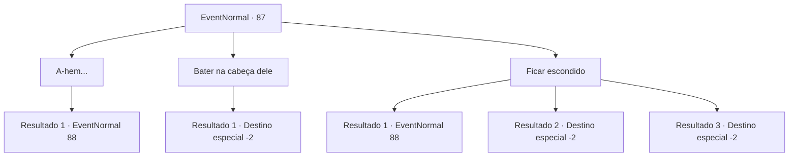

# Eventos normais · 87

[Índice da tabela](index.md) · [Índice geral](../index.md)

ID: `pt:EventNormal:87` · Fonte: `EventNormal4` · Versão: 1.2.47.

Mapeamento estático dos arquivos; a disponibilidade e a execução dependem do estado da run.

## Texto do evento

Você está deitado entre os juncos. A lua brilha forte no céu. Nesse momento, um homem de meia-idade entra no junco e tira a roupa. Ele está vestindo roupas íntimas femininas e começa a dançar ao luar. Ele não parece notar você. 

## Dados de entrada

```json
{
  "id": 87,
  "grade": 1,
  "place": "",
  "required": "5_118_0|1_2_999"
}
```

## Mapa das escolhas



## Escolhas e resultados

### Escolha 1

A-hem...

Requisitos e outros campos da escolha:

```json
{
  "required": ""
}
```

#### Resultado 1.1

Você limpa a garganta e o homem desmaia de surpresa. Você fica parado, olhando para ele. Ele começa a colocar suas roupas de volta. 

 "Por favor, finja que você não viu nada... eu imploro..."

 Você silenciosamente faz um sinal de moeda com os dedos. O homem veste o resto de suas roupas e te entrega 5 ouros.

Continuação registrada: [Evento 88](0088.md) na mesma tabela.

```json
{
  "required": "",
  "chance": "1",
  "nextEvent": 88,
  "type": 2,
  "reward": ""
}
```

### Escolha 2

Bater na cabeça dele

Requisitos e outros campos da escolha:

```json
{
  "required": "2_3_0"
}
```

#### Resultado 2.1

Você não está aberto o suficiente para tolerar tal comportamento. Você pega uma pedra e bate na parte de trás da cabeça dele com ela. Ele morre sem saber por quê.

Continuação registrada: [Destino especial `-2`](../destinos-especiais.md).

```json
{
  "required": "",
  "chance": "1",
  "nextEvent": -2,
  "type": 2,
  "reward": "0_3_-5|0_2_1|0_4_3|5_118_9"
}
```

### Escolha 3

Ficar escondido

Requisitos e outros campos da escolha:

```json
{
  "required": ""
}
```

#### Resultado 3.1

Você tenta ficar escondido nos juncos, mas o homem vê você. Ele começa a colocar suas roupas de volta. 

 "Por favor, finja que você não viu nada... eu imploro..."

 Você silenciosamente faz um sinal de moeda com os dedos. O homem veste o resto de suas roupas e te entrega 5 ouros.

Continuação registrada: [Evento 88](0088.md) na mesma tabela.

```json
{
  "required": "",
  "chance": "17",
  "nextEvent": 88,
  "type": 1,
  "reward": ""
}
```

#### Resultado 3.2

Você fica escondido nos juncos. Ele dança até se cansar, Então ele recupera o fôlego, coloca suas roupas de volta e vai embora.

Continuação registrada: [Destino especial `-2`](../destinos-especiais.md).

```json
{
  "required": "21_5_0",
  "chance": "1|0_6_1",
  "nextEvent": -2,
  "type": 0,
  "reward": "0_2_1|5_118_1"
}
```

#### Resultado 3.3

Você usa suas habilidades furtivas para ficar escondido nos juncos. Ele dança até se cansar, Então ele recupera o fôlego, coloca suas roupas de volta e vai embora.

Continuação registrada: [Destino especial `-2`](../destinos-especiais.md).

```json
{
  "required": "20_5_0",
  "chance": "1|0_6_2",
  "nextEvent": -2,
  "type": 0,
  "reward": "0_2_1|5_118_1"
}
```

## Referências que chegam a este evento

Nenhum `nextEvent` positivo da mesma tabela aponta para este nó. Isso não prova que seja inacessível: sorteio e estado de história podem selecioná-lo.

