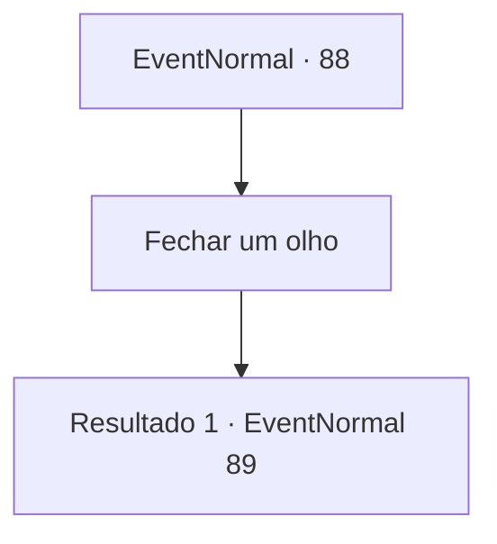

# Eventos normais · 88

[Índice da tabela](index.md) · [Índice geral](../index.md)

ID: `pt:EventNormal:88` · Fonte: `EventNormal4` · Versão: 1.2.47.

Mapeamento estático dos arquivos; a disponibilidade e a execução dependem do estado da run.

## Texto do evento

*Sem texto no arquivo.*

## Dados de entrada

```json
{
  "id": 88,
  "grade": 1,
  "place": "",
  "required": ""
}
```

## Mapa das escolhas



## Escolhas e resultados

### Escolha 1

Fechar um olho

Requisitos e outros campos da escolha:

```json
{
  "required": ""
}
```

#### Resultado 1.1

Você pega o ouro, fecha um olho e finge estar roncando. O homem entende e remexe apressadamente no bolso antes de lhe entregar 5 ouros extras.

Continuação registrada: [Evento 89](0089.md) na mesma tabela.

```json
{
  "required": "",
  "chance": "1",
  "nextEvent": 89,
  "type": 2,
  "reward": ""
}
```

## Referências que chegam a este evento

- [Evento 87 · escolha 1 · resultado 1](0087.md#escolha-1)
- [Evento 87 · escolha 3 · resultado 1](0087.md#escolha-3)
