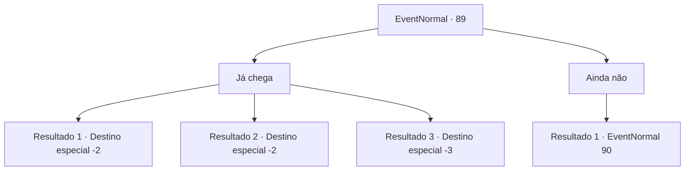

# Eventos normais · 89

[Índice da tabela](index.md) · [Índice geral](../index.md)

ID: `pt:EventNormal:89` · Fonte: `EventNormal4` · Versão: 1.2.47.

Mapeamento estático dos arquivos; a disponibilidade e a execução dependem do estado da run.

## Texto do evento

*Sem texto no arquivo.*

## Dados de entrada

```json
{
  "id": 89,
  "grade": 1,
  "place": "",
  "required": ""
}
```

## Mapa das escolhas



## Escolhas e resultados

### Escolha 1

Já chega

Requisitos e outros campos da escolha:

```json
{
  "required": ""
}
```

#### Resultado 1.1

Você fecha os dois olhos e finge roncar. Você ouve uns sussuros e logo o homem se foi.

Continuação registrada: [Destino especial `-2`](../destinos-especiais.md).

```json
{
  "required": "",
  "chance": "1|0_12_1",
  "nextEvent": -2,
  "type": 0,
  "reward": "0_4_10|0_2_1|5_118_1"
}
```

#### Resultado 1.2

Você fecha os dois olhos e finge roncar. Você ouve uns sussurros, depois um baque pesado contra sua cabeça. Você tenta se levantar, mas seu crânio está zumbindo. Você abre os olhos e vê o homem segurando uma pedra enorme. Ele te bate com a pedra. O seu mundo escurece. 

 Depois de um tempo, você acorda com a testa severamente inchada.

Continuação registrada: [Destino especial `-2`](../destinos-especiais.md).

```json
{
  "required": "1_0_2",
  "chance": "4",
  "nextEvent": -2,
  "type": 1,
  "reward": "0_4_-10|0_0_-1|0_2_1|5_118_2"
}
```

#### Resultado 1.3

Você fecha os dois olhos e finge roncar. Você ouve uns sussurros, depois um baque pesado contra sua cabeça. Você tenta se levantar, mas seu crânio está zumbindo. Você abre os olhos e vê o homem segurando uma pedra enorme. Ele te derruba com a pedra. O seu mundo escurece.

Continuação registrada: [Destino especial `-3`](../destinos-especiais.md).

```json
{
  "required": "2_0_2",
  "chance": "4",
  "nextEvent": -3,
  "type": 1,
  "reward": "0_4_-10|0_0_-1|0_2_1"
}
```

### Escolha 2

Ainda não

Requisitos e outros campos da escolha:

```json
{
  "required": ""
}
```

#### Resultado 2.1

Você faz barulhos de ronco com os dois olhos abertos. O homem está frustrado. 

 "Ah, qual é!"


Continuação registrada: [Evento 90](0090.md) na mesma tabela.

```json
{
  "required": "",
  "chance": "1",
  "nextEvent": 90,
  "type": 2,
  "reward": "6_0_36",
  "place": 14
}
```

## Referências que chegam a este evento

- [Evento 88 · escolha 1 · resultado 1](0088.md#escolha-1)
