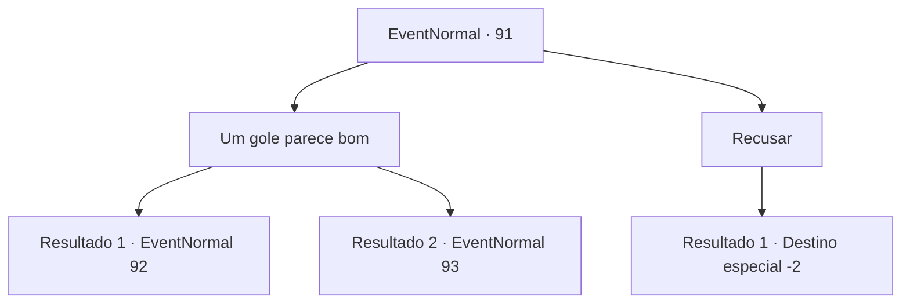

# Eventos normais · 91

[Índice da tabela](index.md) · [Índice geral](../index.md)

ID: `pt:EventNormal:91` · Fonte: `EventNormal4` · Versão: 1.2.47.

Mapeamento estático dos arquivos; a disponibilidade e a execução dependem do estado da run.

## Texto do evento

Você se depara com o herbalista errante novamente. Ele fica emocionado em vê-lo e tira um pequeno frasco. 

 "Isto é pela ajuda que você me deu anteriormente. Vamos, tome um gole. Vai fazer você se sentir incrível."


## Dados de entrada

```json
{
  "id": 91,
  "grade": 1,
  "place": "",
  "required": "5_60_1"
}
```

## Mapa das escolhas



## Escolhas e resultados

### Escolha 1

Um gole parece bom

Requisitos e outros campos da escolha:

```json
{
  "required": ""
}
```

#### Resultado 1.1

Você abre a garrafa e bebe o líquido dentro. Um gosto amargo e suave desce pela garganta. Quando você abre os olhos, o herbalista se foi. Um cervo está olhando para você, sua pele está forrada com o céu noturno e um milhão de estrelas. |drawing_spaceDear|

Continuação registrada: [Evento 92](0092.md) na mesma tabela.

```json
{
  "required": "1_3_0",
  "chance": "1",
  "nextEvent": 92,
  "type": 2,
  "reward": ""
}
```

#### Resultado 1.2

Você abre a garrafa e bebe o líquido dentro. Um gosto amargo e suave desce pela garganta. Quando você abre os olhos, o herbalista se foi. Um lobo tão grande quanto as montanhas está olhando para você. |drawing_giantWolf|

Continuação registrada: [Evento 93](0093.md) na mesma tabela.

```json
{
  "required": "2_3_0",
  "chance": "1",
  "nextEvent": 93,
  "type": 2,
  "reward": ""
}
```

### Escolha 2

Recusar

Requisitos e outros campos da escolha:

```json
{
  "required": ""
}
```

#### Resultado 2.1

Você se recusa a beber da garrafa suspeita. Ele parece bastante desapontado enquanto bebe sozinho. Seus olhos perdem o foco quando ele cai no chão. Parece que ele está dormindo profundamente. Você o deixa para trás e continua sua aventura.

Continuação registrada: [Destino especial `-2`](../destinos-especiais.md).

```json
{
  "required": "",
  "chance": "1",
  "nextEvent": -2,
  "type": 2,
  "reward": "5_60_3"
}
```

## Referências que chegam a este evento

Nenhum `nextEvent` positivo da mesma tabela aponta para este nó. Isso não prova que seja inacessível: sorteio e estado de história podem selecioná-lo.

