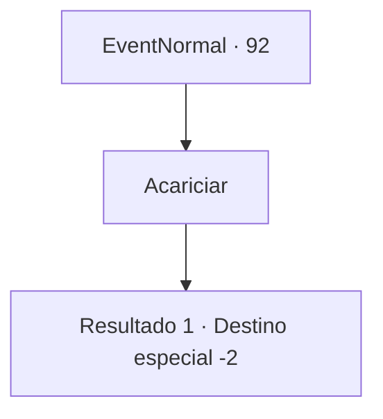

# Eventos normais · 92

[Índice da tabela](index.md) · [Índice geral](../index.md)

ID: `pt:EventNormal:92` · Fonte: `EventNormal4` · Versão: 1.2.47.

Mapeamento estático dos arquivos; a disponibilidade e a execução dependem do estado da run.

## Texto do evento

*Sem texto no arquivo.*

## Dados de entrada

```json
{
  "id": 92,
  "grade": 1,
  "place": "",
  "required": ""
}
```

## Mapa das escolhas



## Escolhas e resultados

### Escolha 1

Acariciar

Requisitos e outros campos da escolha:

```json
{
  "required": ""
}
```

#### Resultado 1.1

Você acaricia o cervo místico. Ele te coloca em suas costas e voa pelo céu. Por um momento, você está no alto entre as estrelas. Quando você pisca, você se encontra deitado no chão. A voz do herbalista confirma que você está de volta à realidade. 

 "E aí? O que você acha? Não é incrível?"

 Ele ri enquanto se afasta.

Continuação registrada: [Destino especial `-2`](../destinos-especiais.md).

```json
{
  "required": "",
  "chance": "1",
  "nextEvent": -2,
  "type": 2,
  "reward": "0_2_1|0_1_1|5_60_2"
}
```

## Referências que chegam a este evento

- [Evento 91 · escolha 1 · resultado 1](0091.md#escolha-1)
