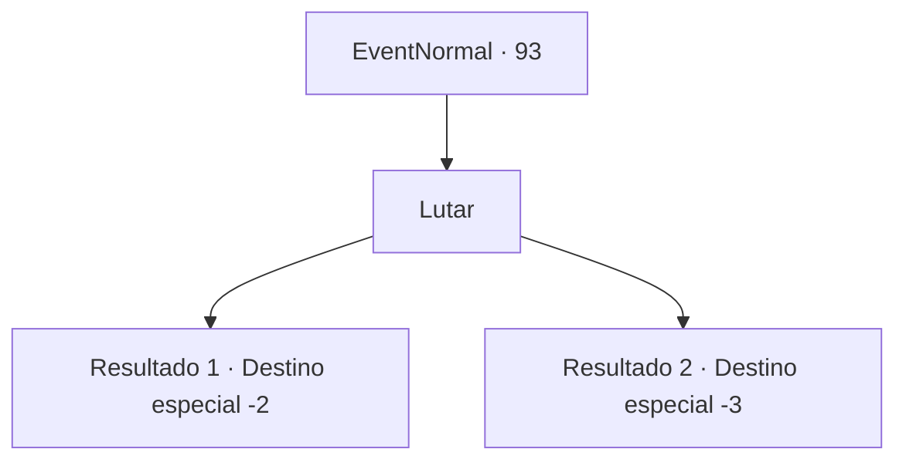

# Eventos normais · 93

[Índice da tabela](index.md) · [Índice geral](../index.md)

ID: `pt:EventNormal:93` · Fonte: `EventNormal4` · Versão: 1.2.47.

Mapeamento estático dos arquivos; a disponibilidade e a execução dependem do estado da run.

## Texto do evento

*Sem texto no arquivo.*

## Dados de entrada

```json
{
  "id": 93,
  "grade": 1,
  "place": "",
  "required": ""
}
```

## Mapa das escolhas



## Escolhas e resultados

### Escolha 1

Lutar

Requisitos e outros campos da escolha:

```json
{
  "required": ""
}
```

#### Resultado 1.1

Você saca sua arma e enfrenta o lobo gigante. Ele abre suas mandíbulas e engole você inteiro. Suas entranhas estão cheias de espíritos malignos. <link=shake>

 "É tudo por sua causa...!"

</link> <link=shake>

 "Socorro! SOCORRO!! ME AJUDEM!!!"

</link> <color=red><link=shake>

 "MORRA,MORRA,MORRA,MORRA,MORRA"

</link></color> Eles o cercam e arrancam sua carne de seus ossos. Você se assusta, percebendo que foi tudo um pesadelo. A voz do herbalista confirma que você está de volta à realidade. 

 "Hmm... então eu acho que não funciona tão bem em você."

 Ele tosse desconfortavelmente enquanto se afasta.

Continuação registrada: [Destino especial `-2`](../destinos-especiais.md).

```json
{
  "required": "1_1_2",
  "chance": "1",
  "nextEvent": -2,
  "type": 2,
  "reward": "0_2_1|0_1_-1|5_60_2"
}
```

#### Resultado 1.2

Você saca sua arma e enfrenta o lobo gigante. Ele abre suas mandíbulas e engole você inteiro. Suas entranhas estão cheias de espíritos malignos. <link=shake>

 "É tudo por sua causa...!"

</link> <link=shake>

 "SOCORRO! SOCORRO!! ME AJUDEM!!!"

</link> <color=red><link=shake>

 "MORRA,MORRA,MORRA,MORRA,MORRA"

</link></color> Eles o cercam e arrancam sua carne de seus ossos. Você perde a consciência de tanta dor.

Continuação registrada: [Destino especial `-3`](../destinos-especiais.md).

```json
{
  "required": "2_1_2",
  "chance": "1",
  "nextEvent": -3,
  "type": 2,
  "reward": "0_1_-1|5_60_2"
}
```

## Referências que chegam a este evento

- [Evento 91 · escolha 1 · resultado 2](0091.md#escolha-1)
