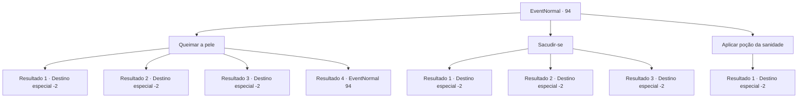

# Eventos normais · 94

[Índice da tabela](index.md) · [Índice geral](../index.md)

ID: `pt:EventNormal:94` · Fonte: `EventNormal4` · Versão: 1.2.47.

Mapeamento estático dos arquivos; a disponibilidade e a execução dependem do estado da run.

## Texto do evento

Você sente uma coceira nas costas. Devem ser as pulgas na pele. 

## Dados de entrada

```json
{
  "id": 94,
  "grade": 1,
  "place": "",
  "required": "8_4_1|5_61_0"
}
```

## Mapa das escolhas



## Escolhas e resultados

### Escolha 1

Queimar a pele

Requisitos e outros campos da escolha:

```json
{
  "required": "5_97_0"
}
```

#### Resultado 1.1

Você pega um fósforo. Então você acende o couro em chamas.
 *Estalo*
 Você observa as chamas até não sobrar nada além de cinzas. Você chuta terra sobre os restos.

Continuação registrada: [Destino especial `-2`](../destinos-especiais.md).

```json
{
  "required": "8_40_1",
  "chance": "1",
  "nextEvent": -2,
  "type": 2,
  "reward": "0_2_1|4_40_1|4_4_1"
}
```

#### Resultado 1.2

Você quebra sua lanterna para iniciar um incêndio. Depois queima o couro com ela.
 *Estalo*
 Você observa as chamas até não sobrar nada além de cinzas. Você chuta terra sobre os restos.

Continuação registrada: [Destino especial `-2`](../destinos-especiais.md).

```json
{
  "required": "8_42_1",
  "chance": "1",
  "nextEvent": -2,
  "type": 2,
  "reward": "0_2_1|4_42_1|4_4_1"
}
```

#### Resultado 1.3

Você pega um fósforo. Então você acende o couro em chamas.
 *Estalo*
 Você observa as chamas até não sobrar nada além de cinzas. Você chuta terra sobre os restos.

Continuação registrada: [Destino especial `-2`](../destinos-especiais.md).

```json
{
  "required": "8_47_1",
  "chance": "1",
  "nextEvent": -2,
  "type": 2,
  "reward": "0_2_1|4_4_1"
}
```

#### Resultado 1.4

Você acha que provavelmente deveria queimá-lo, mas não tem os itens certos para iniciar um incêndio.

Continuação registrada: [Evento 94](0094.md) na mesma tabela.

```json
{
  "required": "10_40_1|10_42_1|10_47_1",
  "chance": "1",
  "nextEvent": 94,
  "type": 2,
  "reward": "5_97_1"
}
```

### Escolha 2

Sacudir-se

Requisitos e outros campos da escolha:

```json
{
  "required": ""
}
```

#### Resultado 2.1

Você sacode o couro o mais forte que pode, esperando que as pulgas saiam. Mas não funciona. Você não tem escolha a não ser aguentar a coceira enquanto continua sua jornada.

Continuação registrada: [Destino especial `-2`](../destinos-especiais.md).

```json
{
  "required": "1_1_2",
  "chance": "10",
  "nextEvent": -2,
  "type": 1,
  "reward": "0_1_-1|0_2_1"
}
```

#### Resultado 2.2

Você sacode o couro o mais forte que pode, esperando que as pulgas saiam. Mas não funciona, e você desmaia de pressão alta depois de ficar estressado com toda a coceira.

Continuação registrada: [Destino especial `-2`](../destinos-especiais.md).

```json
{
  "required": "2_1_2",
  "chance": "10",
  "nextEvent": -2,
  "type": 1,
  "reward": "0_1_-1|0_2_1"
}
```

#### Resultado 2.3

Você sacode a pele o mais forte que pode. As pulgas e os ovos finalmente caem. Você se sente revigorado enquanto continua sua jornada.

Continuação registrada: [Destino especial `-2`](../destinos-especiais.md).

```json
{
  "required": "",
  "chance": "1|0_5_1",
  "nextEvent": -2,
  "type": 0,
  "reward": "0_1_1|0_2_1"
}
```

### Escolha 3

Aplicar poção da sanidade 

Requisitos e outros campos da escolha:

```json
{
  "required": "8_37_1|1_7_9"
}
```

#### Resultado 3.1

Você se lembra de algo que ouviu. Você ouviu uma vez que as poções de sanidade também funcionam como um repelente de pulgas eficaz. Você pega uma poção de sanidade e a aplica no couro. As pulgas fogem de sua superfície. Você resolveu seu problema de coceira.

Continuação registrada: [Destino especial `-2`](../destinos-especiais.md).

```json
{
  "required": "",
  "chance": "1",
  "nextEvent": -2,
  "type": 2,
  "reward": "0_1_1|0_2_2|4_37_1|5_61_1"
}
```

## Referências que chegam a este evento

- [Evento 94 · escolha 1 · resultado 4](0094.md#escolha-1)
