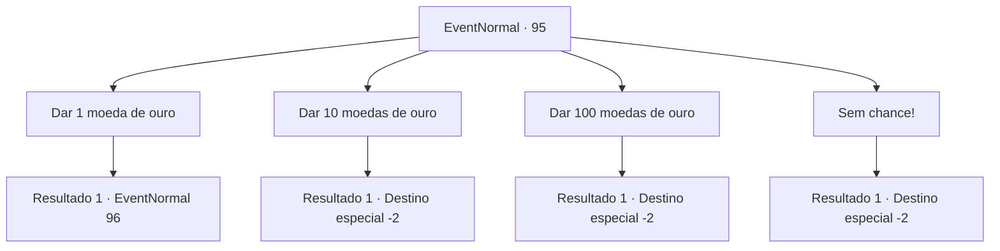

# Eventos normais · 95

[Índice da tabela](index.md) · [Índice geral](../index.md)

ID: `pt:EventNormal:95` · Fonte: `EventNormal4` · Versão: 1.2.47.

Mapeamento estático dos arquivos; a disponibilidade e a execução dependem do estado da run.

## Texto do evento

Um grupo de crianças em trapos se aproxima de você com olhos brilhantes. 

 "Vejam...! Um cavaleiro!"

 "Cavaleiros são ricos, certo?"

 Elas se revezam comentando sobre você. Então uma delas estende a mão. 

 "Por favor, nos dê dinheiro, poderoso cavaleiro!"

 

## Dados de entrada

```json
{
  "id": 95,
  "grade": 1,
  "place": "",
  "required": "20_4_2|5_154_0"
}
```

## Mapa das escolhas



## Escolhas e resultados

### Escolha 1

Dar 1 moeda de ouro

Requisitos e outros campos da escolha:

```json
{
  "required": "1_4_1"
}
```

#### Resultado 1.1

Você joga uma única moeda neles. As crianças brigam entre si para conseguir pegar. Alguns deles voltam choramingando. 

 "Vamos lá... só uma? Sabemos que você tem mais..."


Continuação registrada: [Evento 96](0096.md) na mesma tabela.

```json
{
  "required": "",
  "chance": "1",
  "nextEvent": 96,
  "type": 2,
  "reward": "0_4_-1|0_2_1"
}
```

### Escolha 2

Dar 10 moedas de ouro

Requisitos e outros campos da escolha:

```json
{
  "required": "1_4_10"
}
```

#### Resultado 2.1

Você entrega às crianças 10 moedas de ouro. Eles agradecem e saem com grandes sorrisos em seus rostos.

Continuação registrada: [Destino especial `-2`](../destinos-especiais.md).

```json
{
  "required": "",
  "chance": "1",
  "nextEvent": -2,
  "type": 2,
  "reward": "0_4_-10|0_3_1|0_2_1"
}
```

### Escolha 3

Dar 100 moedas de ouro

Requisitos e outros campos da escolha:

```json
{
  "required": "1_4_100"
}
```

#### Resultado 3.1

Você entrega a eles 100 moedas de ouro em uma bolsa de couro. As crianças começam a brigar entre si. Você se afasta da confusão.

Continuação registrada: [Destino especial `-2`](../destinos-especiais.md).

```json
{
  "required": "",
  "chance": "1",
  "nextEvent": -2,
  "type": 2,
  "reward": "0_4_-100|0_3_3|0_2_1|5_154_0"
}
```

### Escolha 4

Sem chance!

Requisitos e outros campos da escolha:

```json
{
  "required": ""
}
```

#### Resultado 4.1

Você não dá nada a eles. As crianças parecem desapontadas enquanto se afastam.

Continuação registrada: [Destino especial `-2`](../destinos-especiais.md).

```json
{
  "required": "",
  "chance": "1",
  "nextEvent": -2,
  "type": 2,
  "reward": "0_2_1|0_3_-1"
}
```

## Referências que chegam a este evento

Nenhum `nextEvent` positivo da mesma tabela aponta para este nó. Isso não prova que seja inacessível: sorteio e estado de história podem selecioná-lo.

