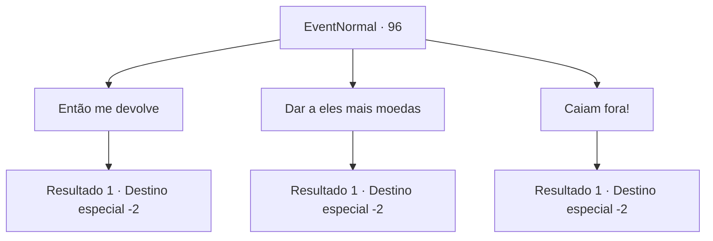

# Eventos normais · 96

[Índice da tabela](index.md) · [Índice geral](../index.md)

ID: `pt:EventNormal:96` · Fonte: `EventNormal4` · Versão: 1.2.47.

Mapeamento estático dos arquivos; a disponibilidade e a execução dependem do estado da run.

## Texto do evento

*Sem texto no arquivo.*

## Dados de entrada

```json
{
  "id": 96,
  "grade": 1,
  "place": "",
  "required": ""
}
```

## Mapa das escolhas



## Escolhas e resultados

### Escolha 1

Então me devolve

Requisitos e outros campos da escolha:

```json
{
  "required": ""
}
```

#### Resultado 1.1

Você dá a eles um olhar severo e pede suas moedas de volta. As crianças balançam a cabeça e fogem.

Continuação registrada: [Destino especial `-2`](../destinos-especiais.md).

```json
{
  "required": "",
  "chance": "1",
  "nextEvent": -2,
  "type": 2,
  "reward": "0_2_1|0_3_-1"
}
```

### Escolha 2

Dar a eles mais moedas

Requisitos e outros campos da escolha:

```json
{
  "required": "1_4_9"
}
```

#### Resultado 2.1

Você dá às crianças um pouco mais de ouro. Elas correm de volta para o grupo - a maioria das quais estão brigando por uma moeda - e mostram o dinheiro extra. Elas param de brigar e dividem seus ganhos para que cada criança ganhe 1 moeda de ouro.

Continuação registrada: [Destino especial `-2`](../destinos-especiais.md).

```json
{
  "required": "",
  "chance": "1",
  "nextEvent": -2,
  "type": 2,
  "reward": "0_2_1|0_4_-9"
}
```

### Escolha 3

Caiam fora!

Requisitos e outros campos da escolha:

```json
{
  "required": ""
}
```

#### Resultado 3.1

Você grita com as crianças. Elas ficam com medo e fogem.

Continuação registrada: [Destino especial `-2`](../destinos-especiais.md).

```json
{
  "required": "",
  "chance": "1",
  "nextEvent": -2,
  "type": 2,
  "reward": "0_3_-1"
}
```

## Referências que chegam a este evento

- [Evento 95 · escolha 1 · resultado 1](0095.md#escolha-1)
