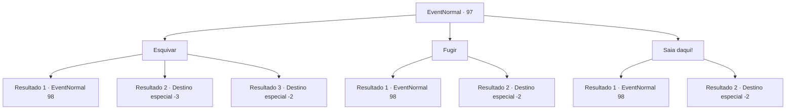

# Eventos normais · 97

[Índice da tabela](index.md) · [Índice geral](../index.md)

ID: `pt:EventNormal:97` · Fonte: `EventNormal4` · Versão: 1.2.47.

Mapeamento estático dos arquivos; a disponibilidade e a execução dependem do estado da run.

## Texto do evento

As nuvens engoliram a lua inteira. Você está acampando em uma cama de folhas caídas. De repente, você vê uma luz vermelha disparando na escuridão. Ele se aproxima de você em uma velocidade alarmante. 

## Dados de entrada

```json
{
  "id": 97,
  "grade": 1,
  "place": "",
  "required": "8_49_1"
}
```

## Mapa das escolhas



## Escolhas e resultados

### Escolha 1

Esquivar

Requisitos e outros campos da escolha:

```json
{
  "required": "1_6_11"
}
```

#### Resultado 1.1

Você pega sua arma e se prepara. Um morcego vampiro voa em sua direção, olhos em chamas. Ele gira no último momento e atinge você de um ângulo inesperado.

Continuação registrada: [Evento 98](0098.md) na mesma tabela.

```json
{
  "required": "1_0_2",
  "chance": "12",
  "nextEvent": 98,
  "type": 1,
  "reward": "6_0_11|0_0_-1",
  "place": 14
}
```

#### Resultado 1.2

Você pega sua arma e se prepara. Um morcego vampiro voa em sua direção, olhos em chamas. Ele gira no último momento e atinge você de um ângulo inesperado. Você leva o golpe e cai no chão.

Continuação registrada: [Destino especial `-3`](../destinos-especiais.md).

```json
{
  "required": "2_0_2",
  "chance": "12",
  "nextEvent": -3,
  "type": 1,
  "reward": "0_0_-1"
}
```

#### Resultado 1.3

Você pega sua arma e se prepara. Um morcego vampiro voa em sua direção, olhos em chamas. Ele gira no último momento e atinge você de um ângulo inesperado. Você é derrotado instantaneamente.

Continuação registrada: [Destino especial `-2`](../destinos-especiais.md).

```json
{
  "required": "",
  "chance": "1|0_7_1",
  "nextEvent": -2,
  "type": 0,
  "reward": "0_2_1|0_4_3"
}
```

### Escolha 2

Fugir

Requisitos e outros campos da escolha:

```json
{
  "required": ""
}
```

#### Resultado 2.1

Você tenta fugir dele através da escuridão. Mas a luz vermelha logo supera você. Logo, um morcego vampiro emerge das sombras, olhos em chamas.

Continuação registrada: [Evento 98](0098.md) na mesma tabela.

```json
{
  "required": "",
  "chance": "13",
  "nextEvent": 98,
  "type": 1,
  "reward": "6_3_11",
  "place": 14
}
```

#### Resultado 2.2

Você se afasta dele através da escuridão. A luz vermelha diminui até desaparecer.

Continuação registrada: [Destino especial `-2`](../destinos-especiais.md).

```json
{
  "required": "",
  "chance": "1|0_6_1",
  "nextEvent": -2,
  "type": 0,
  "reward": ""
}
```

### Escolha 3

Saia daqui!

Requisitos e outros campos da escolha:

```json
{
  "required": ""
}
```

#### Resultado 3.1

Você grita, olhando para a luz vermelha. Mas ela te ignora e continua vindo. Um morcego vampiro voa em sua direção, olhos em chamas.

Continuação registrada: [Evento 98](0098.md) na mesma tabela.

```json
{
  "required": "",
  "chance": "11",
  "nextEvent": 98,
  "type": 1,
  "reward": "6_0_11",
  "place": 14
}
```

#### Resultado 3.2

Você grita, olhando para a luz vermelha. Ela recua e volta atrás.

Continuação registrada: [Destino especial `-2`](../destinos-especiais.md).

```json
{
  "required": "",
  "chance": "1|0_12_1",
  "nextEvent": -2,
  "type": 0,
  "reward": "0_2_1"
}
```

## Referências que chegam a este evento

Nenhum `nextEvent` positivo da mesma tabela aponta para este nó. Isso não prova que seja inacessível: sorteio e estado de história podem selecioná-lo.

