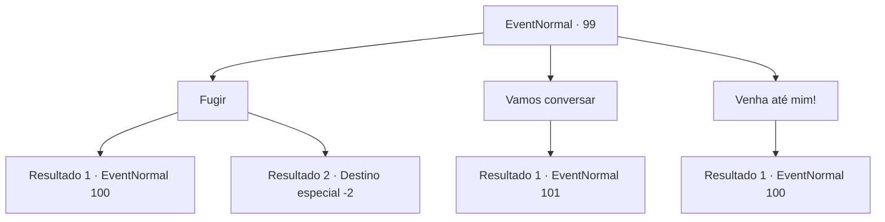

# Eventos normais · 99

[Índice da tabela](index.md) · [Índice geral](../index.md)

ID: `pt:EventNormal:99` · Fonte: `EventNormal4` · Versão: 1.2.47.

Mapeamento estático dos arquivos; a disponibilidade e a execução dependem do estado da run.

## Texto do evento

Você encontra o garoto rico de antes. Ele ordena que um homem grande - provavelmente seu guarda-costas - cuide de você. 

 "É aquele! Foi ele quem me bateu! Você está morto!!"

 O guarda estala o pescoço para a esquerda e para a direita enquanto caminha em sua direção. 

## Dados de entrada

```json
{
  "id": 99,
  "grade": 1,
  "place": "",
  "required": "5_45_1"
}
```

## Mapa das escolhas



## Escolhas e resultados

### Escolha 1

Fugir

Requisitos e outros campos da escolha:

```json
{
  "required": ""
}
```

#### Resultado 1.1

Você corre o mais rápido que pode, mas não é rápido o suficiente. O guarda te alcança e bate sua clava em você.

Continuação registrada: [Evento 100](0100.md) na mesma tabela.

```json
{
  "required": "",
  "chance": "11",
  "nextEvent": 100,
  "type": 1,
  "reward": "6_0_91",
  "place": 4
}
```

#### Resultado 1.2

Você é rápido o suficiente para ultrapassá-lo. Você olha para o garoto que está pulando e reclamando com o guarda. Você sorri e continua sua jornada.

Continuação registrada: [Destino especial `-2`](../destinos-especiais.md).

```json
{
  "required": "",
  "chance": "1|0_6_1",
  "nextEvent": -2,
  "type": 0,
  "reward": "0_2_2|0_1_1"
}
```

### Escolha 2

Vamos conversar

Requisitos e outros campos da escolha:

```json
{
  "required": ""
}
```

#### Resultado 2.1

Você sugere que deve falar sobre isso primeiro. O guarda te agarra e te coloca na frente do garoto. Ele olha para você com condescendência. 

 "Hum. Eu posso te perdoar se você beijar meus pés e pedir desculpas."


Continuação registrada: [Evento 101](0101.md) na mesma tabela.

```json
{
  "required": "",
  "chance": "1",
  "nextEvent": 101,
  "type": 2,
  "reward": ""
}
```

### Escolha 3

Venha até mim!

Requisitos e outros campos da escolha:

```json
{
  "required": ""
}
```

#### Resultado 3.1

Você levanta os braços, pronto para lutar contra o guarda.

Continuação registrada: [Evento 100](0100.md) na mesma tabela.

```json
{
  "required": "",
  "chance": "1",
  "nextEvent": 100,
  "type": 2,
  "reward": "6_0_91",
  "place": 4
}
```

## Referências que chegam a este evento

Nenhum `nextEvent` positivo da mesma tabela aponta para este nó. Isso não prova que seja inacessível: sorteio e estado de história podem selecioná-lo.

