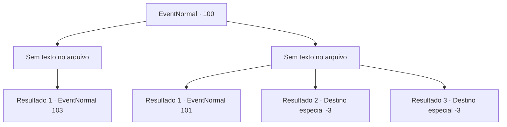

# Eventos normais · 100

[Índice da tabela](index.md) · [Índice geral](../index.md)

ID: `pt:EventNormal:100` · Fonte: `EventNormal4` · Versão: 1.2.47.

Mapeamento estático dos arquivos; a disponibilidade e a execução dependem do estado da run.

## Texto do evento

*Sem texto no arquivo.*

## Dados de entrada

```json
{
  "id": 100,
  "grade": 1,
  "place": "",
  "required": ""
}
```

## Mapa das escolhas



## Escolhas e resultados

### Escolha 1

*Sem texto no arquivo; o papel dessa opção depende da interface do jogo.*

Requisitos e outros campos da escolha:

```json
{
  "required": ""
}
```

#### Resultado 1.1

O guarda cai de lado, segurando o estômago. Parece que você o nocauteou. O menino fica pálido e olha em volta impotente.

Continuação registrada: [Evento 103](0103.md) na mesma tabela.

```json
{
  "required": "",
  "chance": "1",
  "nextEvent": 103,
  "type": 2,
  "reward": ""
}
```

### Escolha 2

*Sem texto no arquivo; o papel dessa opção depende da interface do jogo.*

Requisitos e outros campos da escolha:

```json
{
  "required": ""
}
```

#### Resultado 2.1

O guarda te agarra e te faz ajoelhar na frente do menino. Ele dá um sorriso torto enquanto zomba de você. 

 "Hahaha! Isso é o que você ganha quando esquece quem você é. Eu ainda posso te perdoar se você beijar meus pés e pedir desculpas."


Continuação registrada: [Evento 101](0101.md) na mesma tabela.

```json
{
  "required": "1_0_2|1_1_2",
  "chance": "1",
  "nextEvent": 101,
  "type": 2,
  "reward": "0_0_-1|0_1_-1"
}
```

#### Resultado 2.2

O guarda bate em você e te deixa insconsciente.

Continuação registrada: [Destino especial `-3`](../destinos-especiais.md).

```json
{
  "required": "2_0_2",
  "chance": "1",
  "nextEvent": -3,
  "type": 2,
  "reward": "0_0_-1|0_1_-1"
}
```

#### Resultado 2.3

O guarda bate em você e te deixa insconsciente.

Continuação registrada: [Destino especial `-3`](../destinos-especiais.md).

```json
{
  "required": "2_1_2",
  "chance": "1",
  "nextEvent": -3,
  "type": 2,
  "reward": "0_0_-1|0_1_-1"
}
```

## Referências que chegam a este evento

- [Evento 99 · escolha 1 · resultado 1](0099.md#escolha-1)
- [Evento 99 · escolha 3 · resultado 1](0099.md#escolha-3)
