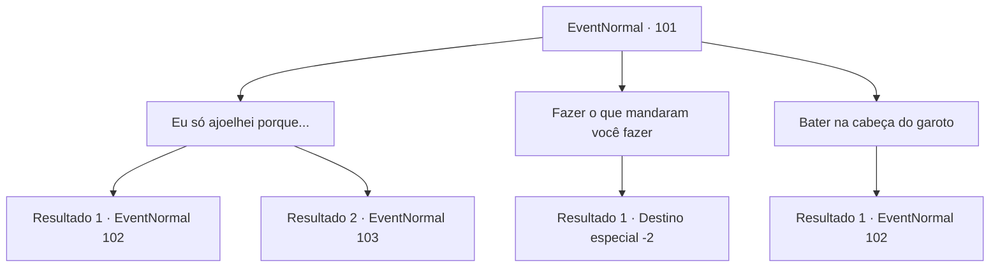

# Eventos normais · 101

[Índice da tabela](index.md) · [Índice geral](../index.md)

ID: `pt:EventNormal:101` · Fonte: `EventNormal4` · Versão: 1.2.47.

Mapeamento estático dos arquivos; a disponibilidade e a execução dependem do estado da run.

## Texto do evento

*Sem texto no arquivo.*

## Dados de entrada

```json
{
  "id": 101,
  "grade": 1,
  "place": "",
  "required": ""
}
```

## Mapa das escolhas



## Escolhas e resultados

### Escolha 1

Eu só ajoelhei porque...

Requisitos e outros campos da escolha:

```json
{
  "required": ""
}
```

#### Resultado 1.1

Você pega impulso com o chão e salta para frente. Você lança seu punho direto no peito do guarda. Seu rosto fica vermelho enquanto ele tosse. Então ele começa a balançar sua clava enquanto avança em você.

Continuação registrada: [Evento 102](0102.md) na mesma tabela.

```json
{
  "required": "",
  "chance": "11",
  "nextEvent": 102,
  "type": 1,
  "reward": "6_2_91",
  "place": 4
}
```

#### Resultado 1.2

Você pega impulso com o chão e salta para frente. Você lança seu punho direto no peito do guarda. Ele se encolhe e cai no chão. Ele parece estar inconsciente. O menino fica pálido e olha em volta impotente.

Continuação registrada: [Evento 103](0103.md) na mesma tabela.

```json
{
  "required": "",
  "chance": "1|0_5_1",
  "nextEvent": 103,
  "type": 0,
  "reward": ""
}
```

### Escolha 2

Fazer o que mandaram você fazer

Requisitos e outros campos da escolha:

```json
{
  "required": "1_1_2"
}
```

#### Resultado 2.1

Você beija os pés do menino e pede perdão a ele. Ele sorri amplamente. <link=wave>

 "Hahaha! Está vendo? Você nasceu para fazer isso e nada mais!"

</link> O menino sai com o guarda depois de rir mais um pouco.

Continuação registrada: [Destino especial `-2`](../destinos-especiais.md).

```json
{
  "required": "",
  "chance": "1",
  "nextEvent": -2,
  "type": 2,
  "reward": "0_1_-1|0_2_1|5_45_9"
}
```

### Escolha 3

Bater na cabeça do garoto

Requisitos e outros campos da escolha:

```json
{
  "required": ""
}
```

#### Resultado 3.1

Você bate no menino malcriado novamente. Ele se cobre e olha para você através de lágrimas. <link=shake>

 "Você, você... me bata de novo!"

</link> Quando o guarda pergunta se ele está bem, o garoto aponta o dedo para você e ordena um ataque.

Continuação registrada: [Evento 102](0102.md) na mesma tabela.

```json
{
  "required": "",
  "chance": "1",
  "nextEvent": 102,
  "type": 2,
  "reward": "6_0_91",
  "place": 4
}
```

## Referências que chegam a este evento

- [Evento 99 · escolha 2 · resultado 1](0099.md#escolha-2)
- [Evento 100 · escolha 2 · resultado 1](0100.md#escolha-2)
