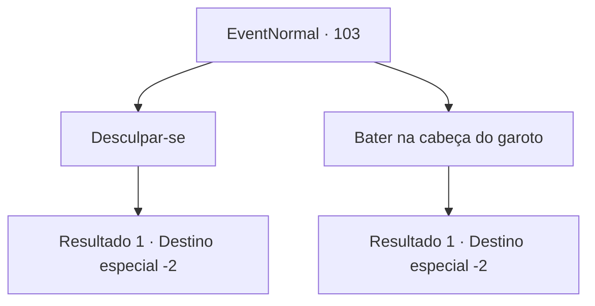

# Eventos normais · 103

[Índice da tabela](index.md) · [Índice geral](../index.md)

ID: `pt:EventNormal:103` · Fonte: `EventNormal4` · Versão: 1.2.47.

Mapeamento estático dos arquivos; a disponibilidade e a execução dependem do estado da run.

## Texto do evento

*Sem texto no arquivo.*

## Dados de entrada

```json
{
  "id": 103,
  "grade": 1,
  "place": "",
  "required": ""
}
```

## Mapa das escolhas



## Escolhas e resultados

### Escolha 1

Desculpar-se

Requisitos e outros campos da escolha:

```json
{
  "required": ""
}
```

#### Resultado 1.1

Você acaricia o menino na cabeça e pede desculpas por ter batido nele. Ele olha para você, confuso. Você o deixa para trás e segue em frente.

Continuação registrada: [Destino especial `-2`](../destinos-especiais.md).

```json
{
  "required": "",
  "chance": "1",
  "nextEvent": -2,
  "type": 2,
  "reward": "5_45_2|0_2_1|0_3_1"
}
```

### Escolha 2

Bater na cabeça do garoto

Requisitos e outros campos da escolha:

```json
{
  "required": ""
}
```

#### Resultado 2.1

Você bate no menino malcriado na cabeça novamente. Ele cai de costas e começa a chorar. Você o deixa e segue em frente.

Continuação registrada: [Destino especial `-2`](../destinos-especiais.md).

```json
{
  "required": "",
  "chance": "1",
  "nextEvent": -2,
  "type": 2,
  "reward": "5_45_3|0_2_1|0_3_-1"
}
```

## Referências que chegam a este evento

- [Evento 100 · escolha 1 · resultado 1](0100.md#escolha-1)
- [Evento 101 · escolha 1 · resultado 2](0101.md#escolha-1)
- [Evento 102 · escolha 1 · resultado 1](0102.md#escolha-1)
