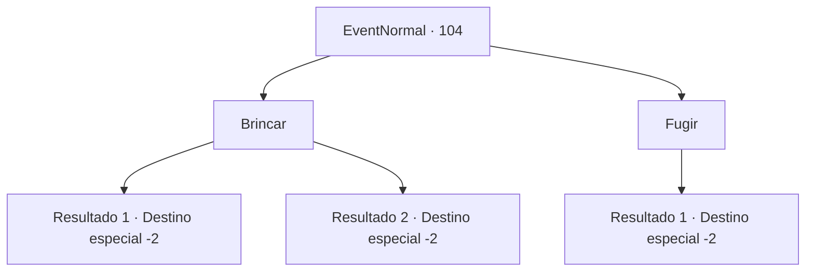

# Eventos normais · 104

[Índice da tabela](index.md) · [Índice geral](../index.md)

ID: `pt:EventNormal:104` · Fonte: `EventNormal4` · Versão: 1.2.47.

Mapeamento estático dos arquivos; a disponibilidade e a execução dependem do estado da run.

## Texto do evento

Você corre para o garoto rico e sua gangue de antes. Todos eles se aproximam de você, os olhos brilham de malícia. 

 "Ei aventureiro, lembra quanto nos divertimos da última vez?"

 O menino diz arrogantemente, e seus seguidores riem. 

## Dados de entrada

```json
{
  "id": 104,
  "grade": 1,
  "place": "",
  "required": "5_45_4"
}
```

## Mapa das escolhas



## Escolhas e resultados

### Escolha 1

Brincar

Requisitos e outros campos da escolha:

```json
{
  "required": "1_1_2"
}
```

#### Resultado 1.1

As crianças torturam você pelo que parece uma eternidade. Está ainda pior do que da última vez. Fadiga imensa aumenta à medida que eles se cansam de você. 

 "Bom trabalho! Até a próxima!"

 O menino rico lhe entrega algumas moedas e sai.

Continuação registrada: [Destino especial `-2`](../destinos-especiais.md).

```json
{
  "required": "",
  "chance": "11",
  "nextEvent": -2,
  "type": 1,
  "reward": "0_1_-1|0_2_1|0_4_5"
}
```

#### Resultado 1.2

Você se torna um instrutor feroz e submete as crianças ao treinamento militar. Oprimidos pelo seu carisma latente, elas fazem o que você manda. Horas depois, as crianças estão sentadas ou deitadas, exaustas. 

 "Ah... eu não consigo me mexer..."

 Elas enxugam o suor de seus rostos com as mãos cobertas de sujeira. O menino rico, ofegante, lhe pergunta. 

 "Então agora... podemos... nos tornar aventureiros legais... como você?"

 Você acena com a cabeça e bagunça o cabelo dele. E então você os deixa para trás e segue em frente.

Continuação registrada: [Destino especial `-2`](../destinos-especiais.md).

```json
{
  "required": "",
  "chance": "1|0_12_1",
  "nextEvent": -2,
  "type": 0,
  "reward": "0_2_2|0_12_1|5_45_5"
}
```

### Escolha 2

Fugir

Requisitos e outros campos da escolha:

```json
{
  "required": ""
}
```

#### Resultado 2.1

Você foge das crianças o mais rápido que pode. Elas não conseguem te alcançar.

Continuação registrada: [Destino especial `-2`](../destinos-especiais.md).

```json
{
  "required": "",
  "chance": "1",
  "nextEvent": -2,
  "type": 2,
  "reward": "0_2_1"
}
```

## Referências que chegam a este evento

Nenhum `nextEvent` positivo da mesma tabela aponta para este nó. Isso não prova que seja inacessível: sorteio e estado de história podem selecioná-lo.

