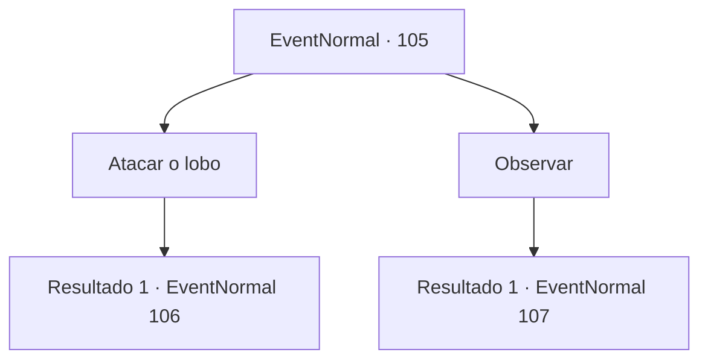

# Eventos normais · 105

[Índice da tabela](index.md) · [Índice geral](../index.md)

ID: `pt:EventNormal:105` · Fonte: `EventNormal4` · Versão: 1.2.47.

Mapeamento estático dos arquivos; a disponibilidade e a execução dependem do estado da run.

## Texto do evento

Você cruzou com um anão pontudo de cabelo verde na floresta. Ele está cuidadosamente observando e desenhando uma planta através de seus óculos. Você se aproxima do anão por curiosidade. E então você percebe um lobo cinza se aproximando dele. Ele está muito focado em seu desenho para notar o seu redor.

## Dados de entrada

```json
{
  "id": 105,
  "grade": 1,
  "place": "",
  "required": "5_70_0"
}
```

## Mapa das escolhas



## Escolhas e resultados

### Escolha 1

Atacar o lobo

Requisitos e outros campos da escolha:

```json
{
  "required": ""
}
```

#### Resultado 1.1

Você ataca o lobo, com a intenção de ajudar o anão vulnerável.

Continuação registrada: [Evento 106](0106.md) na mesma tabela.

```json
{
  "required": "",
  "chance": "1",
  "nextEvent": 106,
  "type": 2,
  "reward": "6_0_3|0_3_1",
  "place": 1
}
```

### Escolha 2

Observar

Requisitos e outros campos da escolha:

```json
{
  "required": ""
}
```

#### Resultado 2.1

Você decide esperar pra ver o que acontece. O lobo se esgueira cada vez mais perto, até que salta para frente com as mandíbulas bem abertas. 

 "Whoah! O que!"

 O anão de cabelos verdes desencadeia algum tipo de explosivo. Seu som ensurdecedor faz o lobo correr. O anão olha ao redor e vê você. Ele te cumprimenta como se nada tivesse acontecido. 

 "Oh, bem-vindo, viajante."


Continuação registrada: [Evento 107](0107.md) na mesma tabela.

```json
{
  "required": "",
  "chance": "1",
  "nextEvent": 107,
  "type": 2,
  "reward": "0_3_-1"
}
```

## Referências que chegam a este evento

Nenhum `nextEvent` positivo da mesma tabela aponta para este nó. Isso não prova que seja inacessível: sorteio e estado de história podem selecioná-lo.

