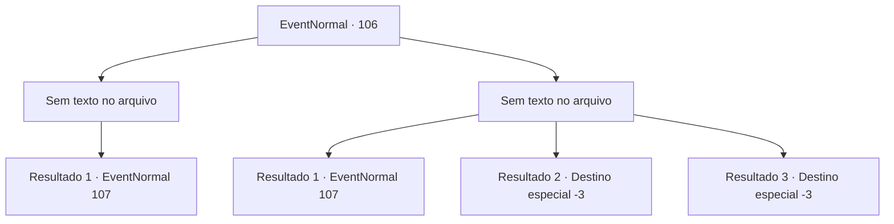

# Eventos normais · 106

[Índice da tabela](index.md) · [Índice geral](../index.md)

ID: `pt:EventNormal:106` · Fonte: `EventNormal4` · Versão: 1.2.47.

Mapeamento estático dos arquivos; a disponibilidade e a execução dependem do estado da run.

## Texto do evento

*Sem texto no arquivo.*

## Dados de entrada

```json
{
  "id": 106,
  "grade": 1,
  "place": "",
  "required": ""
}
```

## Mapa das escolhas



## Escolhas e resultados

### Escolha 1

*Sem texto no arquivo; o papel dessa opção depende da interface do jogo.*

Requisitos e outros campos da escolha:

```json
{
  "required": ""
}
```

#### Resultado 1.1

Você derrota o lobo cinzento. 

 "Whoah! O que!"

 O anão de cabelo verde salta e o cumprimenta. 

 "Oh, bem-vindo, viajante."


Continuação registrada: [Evento 107](0107.md) na mesma tabela.

```json
{
  "required": "",
  "chance": "1",
  "nextEvent": 107,
  "type": 2,
  "reward": ""
}
```

### Escolha 2

*Sem texto no arquivo; o papel dessa opção depende da interface do jogo.*

Requisitos e outros campos da escolha:

```json
{
  "required": ""
}
```

#### Resultado 2.1

O lobo cinzento tenta morder seu pescoço. 

 "Não, você não vai não, vira-lata!"

 O anão de cabelos verdes grita enquanto detona algum tipo de explosivo. Seu som ensurdecedor faz o lobo correr. Então o anão te cumprimenta como se nada tivesse acontecido. 

 "Oh, bem-vindo, viajante."


Continuação registrada: [Evento 107](0107.md) na mesma tabela.

```json
{
  "required": "1_0_2|1_1_2",
  "chance": "1",
  "nextEvent": 107,
  "type": 2,
  "reward": "0_0_-1|0_1_-1"
}
```

#### Resultado 2.2

O lobo tira sua vida.

Continuação registrada: [Destino especial `-3`](../destinos-especiais.md).

```json
{
  "required": "2_0_2",
  "chance": "1",
  "nextEvent": -3,
  "type": 2,
  "reward": "0_0_-1|0_1_-1"
}
```

#### Resultado 2.3

O lobo tira sua vida.

Continuação registrada: [Destino especial `-3`](../destinos-especiais.md).

```json
{
  "required": "2_1_2",
  "chance": "1",
  "nextEvent": -3,
  "type": 2,
  "reward": "0_0_-1|0_1_-1"
}
```

## Referências que chegam a este evento

- [Evento 105 · escolha 1 · resultado 1](0105.md#escolha-1)
