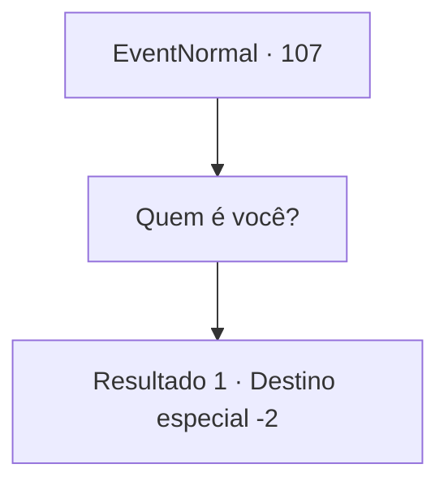

# Eventos normais · 107

[Índice da tabela](index.md) · [Índice geral](../index.md)

ID: `pt:EventNormal:107` · Fonte: `EventNormal4` · Versão: 1.2.47.

Mapeamento estático dos arquivos; a disponibilidade e a execução dependem do estado da run.

## Texto do evento

*Sem texto no arquivo.*

## Dados de entrada

```json
{
  "id": 107,
  "grade": 1,
  "place": "",
  "required": ""
}
```

## Mapa das escolhas



## Escolhas e resultados

### Escolha 1

Quem é você?

Requisitos e outros campos da escolha:

```json
{
  "required": ""
}
```

#### Resultado 1.1

O anão mexe nos óculos enquanto fala. 

 "Bem, isso acontece de vez em quando, se você é um entusiasta de ervas como eu."

 Ele começa a falar sobre todas as diferentes plantas que descobriu. Você não está interessado nelas, mas ele simplesmente não para. Isso pode continuar para sempre. 

 Depois do que parecem horas, o anão se apresenta como 'MV', abreviação de Mushroom Venom. 

 "Ah! Está ficando tarde! Até mais, viajante!"

 De repente, ele afirma que está atrasado e sai correndo.

Continuação registrada: [Destino especial `-2`](../destinos-especiais.md).

```json
{
  "required": "",
  "chance": "1",
  "nextEvent": -2,
  "type": 2,
  "reward": "5_70_1|0_2_1"
}
```

## Referências que chegam a este evento

- [Evento 105 · escolha 2 · resultado 1](0105.md#escolha-2)
- [Evento 106 · escolha 1 · resultado 1](0106.md#escolha-1)
- [Evento 106 · escolha 2 · resultado 1](0106.md#escolha-2)
