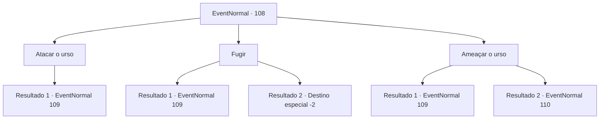

# Eventos normais · 108

[Índice da tabela](index.md) · [Índice geral](../index.md)

ID: `pt:EventNormal:108` · Fonte: `EventNormal4` · Versão: 1.2.47.

Mapeamento estático dos arquivos; a disponibilidade e a execução dependem do estado da run.

## Texto do evento

Você encontra aquele anão chamado MV, de cabelos verdes e pontudos, pendurado em um galho de árvore. Um enorme urso marrom está arranhando o tronco, olhando para ele. O anão acena para você com um punhado de videiras amarelas. 

 "Aopa- Quase que eu caio, aqui!"

 Ele grita, quase perdendo o equilíbrio, pelo urso sacudir a árvore.

## Dados de entrada

```json
{
  "id": 108,
  "grade": 1,
  "place": "",
  "required": "5_70_1"
}
```

## Mapa das escolhas



## Escolhas e resultados

### Escolha 1

Atacar o urso

Requisitos e outros campos da escolha:

```json
{
  "required": ""
}
```

#### Resultado 1.1

Você avança contra o urso para ajudar MV.

Continuação registrada: [Evento 109](0109.md) na mesma tabela.

```json
{
  "required": "",
  "chance": "1",
  "nextEvent": 109,
  "type": 2,
  "reward": "6_0_77",
  "place": 1
}
```

### Escolha 2

Fugir

Requisitos e outros campos da escolha:

```json
{
  "required": ""
}
```

#### Resultado 2.1

Você tenta correr, mas o urso pardo é mais rápido que você.

Continuação registrada: [Evento 109](0109.md) na mesma tabela.

```json
{
  "required": "",
  "chance": "10",
  "nextEvent": 109,
  "type": 1,
  "reward": "6_0_77|0_3_-2",
  "place": 1
}
```

#### Resultado 2.2

Você deixa o MV para trás e corre o mais rápido que consegue. Ele persegue você, mas você o supera com sucesso.

Continuação registrada: [Destino especial `-2`](../destinos-especiais.md).

```json
{
  "required": "",
  "chance": "1|0_6_1",
  "nextEvent": -2,
  "type": 0,
  "reward": "5_70_4|0_3_-2"
}
```

### Escolha 3

Ameaçar o urso

Requisitos e outros campos da escolha:

```json
{
  "required": ""
}
```

#### Resultado 3.1

Você grita ameaçadoramente para o urso. Mas provoca ainda mais a fera. Ele avança até você, a baba escorre pelo lado de suas mandíbulas.

Continuação registrada: [Evento 109](0109.md) na mesma tabela.

```json
{
  "required": "",
  "chance": "13",
  "nextEvent": 109,
  "type": 1,
  "reward": "6_3_77",
  "place": 1
}
```

#### Resultado 3.2

Você grita ameaçadoramente para o urso. A fera marrom estremece e foge. 

 "Ufa... essa foi por pouco!"

 O anão te dá as boas-vindas e agradece.

Continuação registrada: [Evento 110](0110.md) na mesma tabela.

```json
{
  "required": "",
  "chance": "1|0_12_1",
  "nextEvent": 110,
  "type": 0,
  "reward": "0_2_2|0_3_2"
}
```

## Referências que chegam a este evento

Nenhum `nextEvent` positivo da mesma tabela aponta para este nó. Isso não prova que seja inacessível: sorteio e estado de história podem selecioná-lo.

