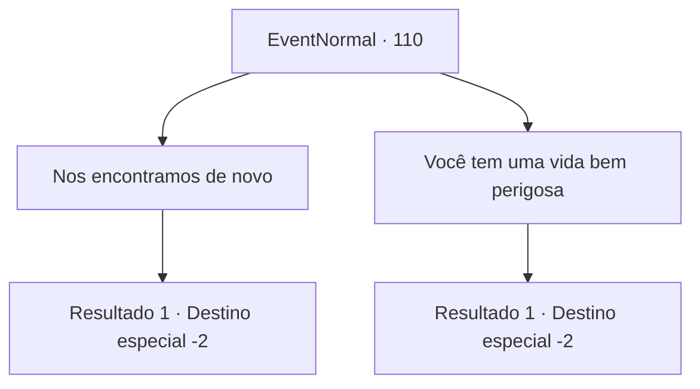

# Eventos normais · 110

[Índice da tabela](index.md) · [Índice geral](../index.md)

ID: `pt:EventNormal:110` · Fonte: `EventNormal4` · Versão: 1.2.47.

Mapeamento estático dos arquivos; a disponibilidade e a execução dependem do estado da run.

## Texto do evento

*Sem texto no arquivo.*

## Dados de entrada

```json
{
  "id": 110,
  "grade": 1,
  "place": "",
  "required": ""
}
```

## Mapa das escolhas



## Escolhas e resultados

### Escolha 1

Nos encontramos de novo

Requisitos e outros campos da escolha:

```json
{
  "required": ""
}
```

#### Resultado 1.1

Você cumprimenta o anão de volta. Ele agradece mais uma vez por salvar sua vida. Então ele de alguma forma conta uma história sobre as vinhas amarelas que ele está segurando. Você sente uma alegria infantil em sua voz, apesar do fato de que vocês dois quase perderam suas vidas para o urso. MV fala sem parar sobre plantas enquanto você o ouve. Você se separa dele por volta do pôr do sol.

Continuação registrada: [Destino especial `-2`](../destinos-especiais.md).

```json
{
  "required": "",
  "chance": "1",
  "nextEvent": -2,
  "type": 2,
  "reward": "5_70_2|0_2_1"
}
```

### Escolha 2

Você tem uma vida bem perigosa

Requisitos e outros campos da escolha:

```json
{
  "required": ""
}
```

#### Resultado 2.1

Você avisa ao MV sobre o perigo de seu estilo de vida. Ele comenta que novas descobertas sempre vêm com riscos e agradece por salvar sua vida. Então ele de alguma forma segue em uma história sobre as vinhas amarelas que ele está segurando. Você sente uma alegria infantil em sua voz, apesar do fato de que vocês dois quase perderam suas vidas para o urso. MV fala sem parar sobre plantas enquanto você o ouve. Você se separa dele por volta do pôr do sol.

Continuação registrada: [Destino especial `-2`](../destinos-especiais.md).

```json
{
  "required": "",
  "chance": "1",
  "nextEvent": -2,
  "type": 2,
  "reward": "5_70_2|0_2_1"
}
```

## Referências que chegam a este evento

- [Evento 108 · escolha 3 · resultado 2](0108.md#escolha-3)
- [Evento 109 · escolha 1 · resultado 1](0109.md#escolha-1)
- [Evento 109 · escolha 2 · resultado 1](0109.md#escolha-2)
