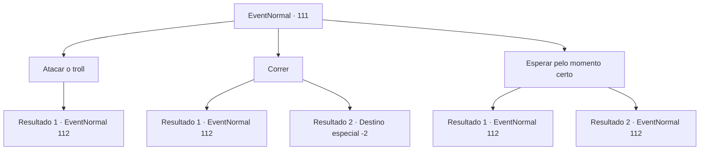

# Eventos normais · 111

[Índice da tabela](index.md) · [Índice geral](../index.md)

ID: `pt:EventNormal:111` · Fonte: `EventNormal4` · Versão: 1.2.47.

Mapeamento estático dos arquivos; a disponibilidade e a execução dependem do estado da run.

## Texto do evento

Você se depara com um anão de cabelo verde muito familiar fugindo de alguma coisa. 

 "Socorro! Ajude-me!!"

 Ele vê você e começa a correr em sua direção. Atrás dele está um troll gigante que ele provocou de alguma forma, rugindo e avançando em direção ao anão.

## Dados de entrada

```json
{
  "id": 111,
  "grade": 1,
  "place": "",
  "required": "5_70_2|1_2_40"
}
```

## Mapa das escolhas



## Escolhas e resultados

### Escolha 1

Atacar o troll

Requisitos e outros campos da escolha:

```json
{
  "required": ""
}
```

#### Resultado 1.1

Você passa correndo pelo MV e em direção ao troll que está chegando, com a arma na mão!

Continuação registrada: [Evento 112](0112.md) na mesma tabela.

```json
{
  "required": "",
  "chance": "1",
  "nextEvent": 112,
  "type": 2,
  "reward": "6_0_9",
  "place": 1
}
```

### Escolha 2

Correr

Requisitos e outros campos da escolha:

```json
{
  "required": ""
}
```

#### Resultado 2.1

Assim que você está prestes a fugir, MV pega suas roupas e se esconde atrás de você. Você não tem escolha a não ser enfrentar o troll.

Continuação registrada: [Evento 112](0112.md) na mesma tabela.

```json
{
  "required": "",
  "chance": "12",
  "nextEvent": 112,
  "type": 1,
  "reward": "6_0_9|0_3_-2",
  "place": 1
}
```

#### Resultado 2.2


 "Ei! Não me abandona aqui!"

 MV grita atrás de você, mas você corre sem olhar para trás.

Continuação registrada: [Destino especial `-2`](../destinos-especiais.md).

```json
{
  "required": "",
  "chance": "1|0_6_1",
  "nextEvent": -2,
  "type": 0,
  "reward": "5_70_4|0_3_-2"
}
```

### Escolha 3

Esperar pelo momento certo

Requisitos e outros campos da escolha:

```json
{
  "required": "1_6_9"
}
```

#### Resultado 3.1

Você decide esperar o momento certo. MV passa por você, ofegante, seguido logo depois pelo troll. Você tenta desferir um golpe letal bem cronometrado, mas não funciona. Você provocou ainda mais o troll e agora ele balança seus punhos gigantes para você.

Continuação registrada: [Evento 112](0112.md) na mesma tabela.

```json
{
  "required": "",
  "chance": "11",
  "nextEvent": 112,
  "type": 1,
  "reward": "6_3_9",
  "place": 1
}
```

#### Resultado 3.2

Você decide esperar o momento certo. MV passa por você, ofegante, seguido logo depois pelo troll. Você desfere um golpe letal bem cronometrado. O troll cai no local. 

 "Isso... é impressionante!"

 À medida que o MV encantado se aproxima de você, o troll se levanta. Fumegando de raiva, ele avança em você mais uma vez.

Continuação registrada: [Evento 112](0112.md) na mesma tabela.

```json
{
  "required": "",
  "chance": "1|0_7_1",
  "nextEvent": 112,
  "type": 0,
  "reward": "6_2_9",
  "place": 1
}
```

## Referências que chegam a este evento

Nenhum `nextEvent` positivo da mesma tabela aponta para este nó. Isso não prova que seja inacessível: sorteio e estado de história podem selecioná-lo.

