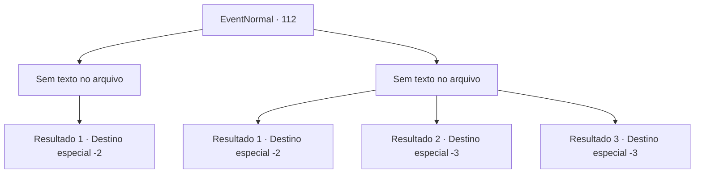

# Eventos normais · 112

[Índice da tabela](index.md) · [Índice geral](../index.md)

ID: `pt:EventNormal:112` · Fonte: `EventNormal4` · Versão: 1.2.47.

Mapeamento estático dos arquivos; a disponibilidade e a execução dependem do estado da run.

## Texto do evento

*Sem texto no arquivo.*

## Dados de entrada

```json
{
  "id": 112,
  "grade": 1,
  "place": "",
  "required": ""
}
```

## Mapa das escolhas



## Escolhas e resultados

### Escolha 1

*Sem texto no arquivo; o papel dessa opção depende da interface do jogo.*

Requisitos e outros campos da escolha:

```json
{
  "required": ""
}
```

#### Resultado 1.1

MV agradece de uma maneira muito familiar. 

 "Vamos ver, vamos ver, vamos ver... Ah!"

 Ele pega um cogumelo vermelho brilhante em forma de orelha. Ele afirma ter provocado o troll ao tentar adquiri-lo. Então ele entrega a você como um sinal de gratidão. Ele explica que é uma espécie rara chamada cogumelo trollear que só cresce em certos trolls e que faz coisas maravilhosas quando consumido. Ele explica seus efeitos com grandes detalhes até que o sol se ponha. 

 "Bem, até mais!"

 Então ele se afasta tão abruptamente quanto encontrou você.

Continuação registrada: [Destino especial `-2`](../destinos-especiais.md).

```json
{
  "required": "",
  "chance": "1",
  "nextEvent": -2,
  "type": 2,
  "reward": "5_70_4|3_134_1|0_2_2|0_3_2"
}
```

### Escolha 2

*Sem texto no arquivo; o papel dessa opção depende da interface do jogo.*

Requisitos e outros campos da escolha:

```json
{
  "required": ""
}
```

#### Resultado 2.1

O troll te derruba. MV tenta distrair o troll cantando uma música com todos seus pulmões. O troll fica louco e começa a perseguir MV. 

 "Agora! Corre!"

 Você se levanta e faz o que o anão manda.

Continuação registrada: [Destino especial `-2`](../destinos-especiais.md).

```json
{
  "required": "1_0_2|1_1_2",
  "chance": "1",
  "nextEvent": -2,
  "type": 2,
  "reward": "5_70_4|0_0_-1|0_1_-1"
}
```

#### Resultado 2.2

O troll te bate.

Continuação registrada: [Destino especial `-3`](../destinos-especiais.md).

```json
{
  "required": "2_0_2",
  "chance": "1",
  "nextEvent": -3,
  "type": 2,
  "reward": "0_0_-1|0_1_-1"
}
```

#### Resultado 2.3

O troll te bate.

Continuação registrada: [Destino especial `-3`](../destinos-especiais.md).

```json
{
  "required": "2_1_2",
  "chance": "1",
  "nextEvent": -3,
  "type": 2,
  "reward": "0_0_-1|0_1_-1"
}
```

## Referências que chegam a este evento

- [Evento 111 · escolha 1 · resultado 1](0111.md#escolha-1)
- [Evento 111 · escolha 2 · resultado 1](0111.md#escolha-2)
- [Evento 111 · escolha 3 · resultado 1](0111.md#escolha-3)
- [Evento 111 · escolha 3 · resultado 2](0111.md#escolha-3)
