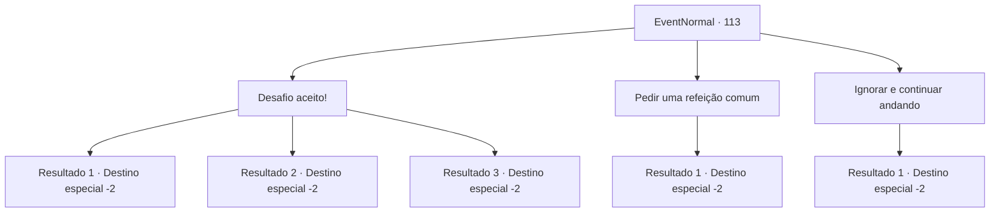

# Eventos normais · 113

[Índice da tabela](index.md) · [Índice geral](../index.md)

ID: `pt:EventNormal:113` · Fonte: `EventNormal4` · Versão: 1.2.47.

Mapeamento estático dos arquivos; a disponibilidade e a execução dependem do estado da run.

## Texto do evento

Você lê uma placa pendurada em um restaurante. É o 'Restaurante Dragão Vermelho', famoso por seus pratos picantes. 

 "O Sabor do Fogo! Experimente a nossa nova Sopa de Sopro do Dragão Vermelho! Grátis para quem terminar em 15 minutos. 15 ouros para quem bater o recorde! Se falhar, pagará 10 ouros."

 

## Dados de entrada

```json
{
  "id": 113,
  "grade": 1,
  "place": "",
  "required": "5_71_0"
}
```

## Mapa das escolhas



## Escolhas e resultados

### Escolha 1

Desafio aceito!

Requisitos e outros campos da escolha:

```json
{
  "required": "1_4_10"
}
```

#### Resultado 1.1

Você decide experimentar a sopa. O garçom traz uma tigela com um líquido vermelho-escuro fervente que lembra lava. Você começa a comer imediatamente. A sopa praticamente queima sua língua e você quase desmaia. Você sai da lanchonete, babando e com menos 10 de ouro.

Continuação registrada: [Destino especial `-2`](../destinos-especiais.md).

```json
{
  "required": "",
  "chance": "24",
  "nextEvent": -2,
  "type": 1,
  "reward": "0_4_-10|0_2_1"
}
```

#### Resultado 1.2

Você decide experimentar a sopa. O garçom traz uma tigela com um líquido vermelho-escuro fervente que lembra lava. Você começa a comer imediatamente. A sopa praticamente queima sua língua, mas você consegue terminar a sopa. Você marcha triunfante para fora do restaurante depois.

Continuação registrada: [Destino especial `-2`](../destinos-especiais.md).

```json
{
  "required": "",
  "chance": "1|0_13_1",
  "nextEvent": -2,
  "type": 0,
  "reward": "0_0_1"
}
```

#### Resultado 1.3

Você decide experimentar a sopa. O garçom traz uma tigela com um líquido vermelho-escuro fervente que lembra lava. Você começa a comer imediatamente. A sopa com certeza é picante, mas você não está muito impressionado. Uma multidão se reúne e torce por você. Quando você termina de comer, percebe que bateu o recorde do restaurante. O proprietário aplaude e lhe entrega o prêmio em dinheiro. Você pega e marcha triunfante para fora do restaurante.

Continuação registrada: [Destino especial `-2`](../destinos-especiais.md).

```json
{
  "required": "",
  "chance": "1|0_13_1",
  "nextEvent": -2,
  "type": 0,
  "reward": "0_4_15|5_71_1|0_0_1|0_1_1|0_2_1"
}
```

### Escolha 2

Pedir uma refeição comum

Requisitos e outros campos da escolha:

```json
{
  "required": "1_4_5"
}
```

#### Resultado 2.1

Você pede uma refeição popular que é menos picante. Tem tempero suficiente para isso, e você gosta bastante. Você se sente reabastecido o suficiente para continuar sua jornada.

Continuação registrada: [Destino especial `-2`](../destinos-especiais.md).

```json
{
  "required": "",
  "chance": "1",
  "nextEvent": -2,
  "type": 2,
  "reward": "0_4_-5|0_0_1|0_2_1"
}
```

### Escolha 3

Ignorar e continuar andando

Requisitos e outros campos da escolha:

```json
{
  "required": ""
}
```

#### Resultado 3.1

Você passa pelo Restaurante Dragão Vermelho

Continuação registrada: [Destino especial `-2`](../destinos-especiais.md).

```json
{
  "required": "",
  "chance": "1",
  "nextEvent": -2,
  "type": 2,
  "reward": ""
}
```

## Referências que chegam a este evento

Nenhum `nextEvent` positivo da mesma tabela aponta para este nó. Isso não prova que seja inacessível: sorteio e estado de história podem selecioná-lo.

