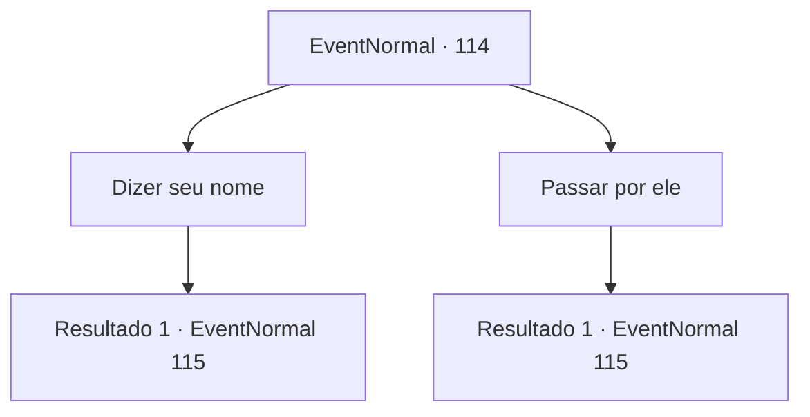

# Eventos normais · 114

[Índice da tabela](index.md) · [Índice geral](../index.md)

ID: `pt:EventNormal:114` · Fonte: `EventNormal4` · Versão: 1.2.47.

Mapeamento estático dos arquivos; a disponibilidade e a execução dependem do estado da run.

## Texto do evento

Você se depara com o híbrido humano-vampiro de antes em um penhasco perto do oceano. É Rome, aquele que você encontrou discutindo com uma mulher chamada Lexie. Ele se senta ao lado de uma vara de pescar, olhando fixamente para o oceano, até que ele ouve você e se vira para uma saudação. 

 "Olá... Você é uh..."

 Ele percebe que não se lembra do seu nome. Ele coça a cabeça e pergunta pelo seu nome.

## Dados de entrada

```json
{
  "id": 114,
  "grade": 1,
  "place": "",
  "required": "5_47_3"
}
```

## Mapa das escolhas



## Escolhas e resultados

### Escolha 1

Dizer seu nome

Requisitos e outros campos da escolha:

```json
{
  "required": ""
}
```

#### Resultado 1.1


 "Ah, sim, certo."

 Ele lhe entrega uma vara de pescar. Você pega enquanto ele se senta e começa a falar. 

 "Você estava certo, sabe. Lexie me deixou depois daquilo."

 Ele explica que Lexie o deixou pelo 'amigo' como ele suspeitava. Ele suspira e olha para o mar. 

 "O que você faria, {1}?"

 Você sente a raiva e o vazio dele ao mesmo tempo.

Continuação registrada: [Evento 115](0115.md) na mesma tabela.

```json
{
  "required": "",
  "chance": "1",
  "nextEvent": 115,
  "type": 2,
  "reward": "3_43_1"
}
```

### Escolha 2

Passar por ele

Requisitos e outros campos da escolha:

```json
{
  "required": ""
}
```

#### Resultado 2.1

Você sente que o encontro levaria muito tempo e tenta passar por ele. Mas ele para você de qualquer maneira e começa a falar. 

 "Você estava certo, sabe. Lexie me deixou depois daqulo."

 Ele explica que Lexie o deixou pelo 'amigo' como ele suspeitava. Ele suspira e olha para o mar. 

 "O que você faria,?"

 Você sente a raiva e o vazio dele ao mesmo tempo.

Continuação registrada: [Evento 115](0115.md) na mesma tabela.

```json
{
  "required": "",
  "chance": "1",
  "nextEvent": 115,
  "type": 2,
  "reward": ""
}
```

## Referências que chegam a este evento

Nenhum `nextEvent` positivo da mesma tabela aponta para este nó. Isso não prova que seja inacessível: sorteio e estado de história podem selecioná-lo.

