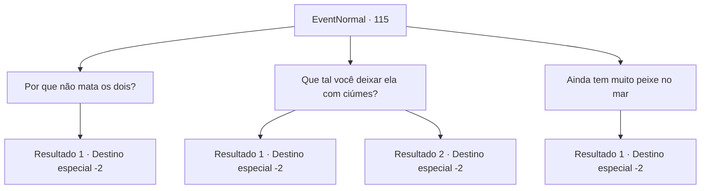

# Eventos normais · 115

[Índice da tabela](index.md) · [Índice geral](../index.md)

ID: `pt:EventNormal:115` · Fonte: `EventNormal4` · Versão: 1.2.47.

Mapeamento estático dos arquivos; a disponibilidade e a execução dependem do estado da run.

## Texto do evento

*Sem texto no arquivo.*

## Dados de entrada

```json
{
  "id": 115,
  "grade": 1,
  "place": "",
  "required": ""
}
```

## Mapa das escolhas



## Escolhas e resultados

### Escolha 1

Por que não mata os dois?

Requisitos e outros campos da escolha:

```json
{
  "required": "2_3_0"
}
```

#### Resultado 1.1

Rome balança a cabeça. 

 "Não, não... estou com raiva dela, sim, mas meu coração ainda anseia por ela."

 A vara de pescar balança para o lado. Você se concentra nela por um tempo antes de pegar uma cavala. Quando você olha para cima, Rome se foi. 

Continuação registrada: [Destino especial `-2`](../destinos-especiais.md).

```json
{
  "required": "",
  "chance": "1",
  "nextEvent": -2,
  "type": 2,
  "reward": "0_2_1|3_124_1|5_47_4"
}
```

### Escolha 2

Que tal você deixar ela com ciúmes?

Requisitos e outros campos da escolha:

```json
{
  "required": ""
}
```

#### Resultado 2.1

Você olha para sua vara de pescar enquanto dá conselhos sobre como recuperar Lexie. Rome acena com a cabeça e ouve atentamente. Mas ele não está muito convencido. 

 "Você... acha que vai funcionar?"

 A vara de pescar balança para o lado. Você se concentra nela por um tempo antes de pegar uma cavala. Quando você olha para cima, Rome se foi. 

Continuação registrada: [Destino especial `-2`](../destinos-especiais.md).

```json
{
  "required": "",
  "chance": "11",
  "nextEvent": -2,
  "type": 1,
  "reward": "0_2_1|3_124_1|5_47_5"
}
```

#### Resultado 2.2

Você tem uma ideia brilhante. Rome acena com a cabeça e ouve atentamente. 

 "Entendo, entendo... Tudo bem, farei o que você disser."

 Ele agradece e lhe entrega algumas moedas de ouro antes de sair.

Continuação registrada: [Destino especial `-2`](../destinos-especiais.md).

```json
{
  "required": "",
  "chance": "1|0_7_1",
  "nextEvent": -2,
  "type": 0,
  "reward": "0_2_1|5_47_7|0_4_15"
}
```

### Escolha 3

Ainda tem muito peixe no mar

Requisitos e outros campos da escolha:

```json
{
  "required": ""
}
```

#### Resultado 3.1

Rome balança a cabeça. 

 "Não, não... estou com raiva dela, sim, mas meu coração ainda anseia por ela."

 A vara de pescar balança para o lado. Você se concentra nela por um tempo antes de pegar uma cavala. Quando você olha para cima, Rome se foi. 

Continuação registrada: [Destino especial `-2`](../destinos-especiais.md).

```json
{
  "required": "",
  "chance": "1",
  "nextEvent": -2,
  "type": 2,
  "reward": "0_2_1|3_124_1|5_47_4"
}
```

## Referências que chegam a este evento

- [Evento 114 · escolha 1 · resultado 1](0114.md#escolha-1)
- [Evento 114 · escolha 2 · resultado 1](0114.md#escolha-2)
