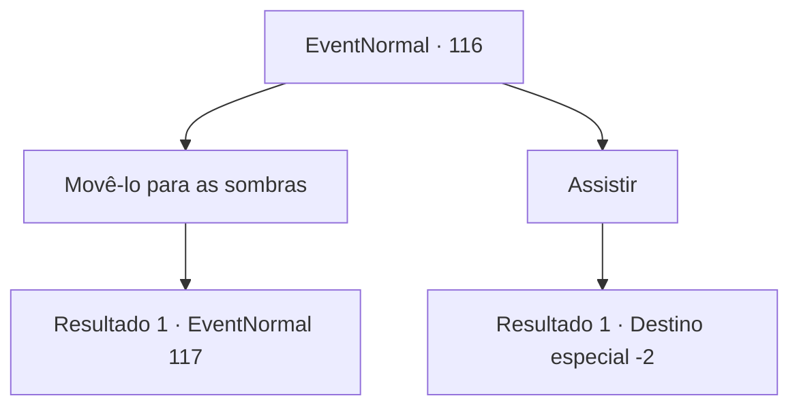

# Eventos normais · 116

[Índice da tabela](index.md) · [Índice geral](../index.md)

ID: `pt:EventNormal:116` · Fonte: `EventNormal4` · Versão: 1.2.47.

Mapeamento estático dos arquivos; a disponibilidade e a execução dependem do estado da run.

## Texto do evento

Você vê um grupo de pessoas aglomeradas em torno de algo. Você passa por eles para encontrar uma figura fumando, deitada no chão. É Rome, o híbrido humano-vampiro que você conheceu antes. Ele o reconhece e o cumprimenta com uma voz fraca. 

 "Oh, é você... Estava esperando que ninguém que eu conhecesse me visse assim..."

 Ele está se banhando na luz quente do sol, que o queima lentamente.

## Dados de entrada

```json
{
  "id": 116,
  "grade": 1,
  "place": "",
  "required": "5_47_4"
}
```

## Mapa das escolhas



## Escolhas e resultados

### Escolha 1

Movê-lo para as sombras

Requisitos e outros campos da escolha:

```json
{
  "required": ""
}
```

#### Resultado 1.1

Você carrega Rome para uma área sombreada. Um padre emerge da multidão e pergunta a você. 

 "Esse homem é uma fera amaldiçoada. Você não viu a luz do sol queimando sua pele? Por que escolhe salvar essa vida?"

 Ele aponta sua varinha para você com as mãos tremendo.

Continuação registrada: [Evento 117](0117.md) na mesma tabela.

```json
{
  "required": "",
  "chance": "1",
  "nextEvent": 117,
  "type": 2,
  "reward": ""
}
```

### Escolha 2

Assistir

Requisitos e outros campos da escolha:

```json
{
  "required": ""
}
```

#### Resultado 2.1

Você vê como a vida de Rome desaparece lentamente. Ele queima até não restar nada dele além de uma silhueta carbonizada. O vento leva suas cinzas para longe. E com isso, a multidão também se dispersa.

Continuação registrada: [Destino especial `-2`](../destinos-especiais.md).

```json
{
  "required": "",
  "chance": "1",
  "nextEvent": -2,
  "type": 2,
  "reward": "0_2_1|5_47_6"
}
```

## Referências que chegam a este evento

Nenhum `nextEvent` positivo da mesma tabela aponta para este nó. Isso não prova que seja inacessível: sorteio e estado de história podem selecioná-lo.

