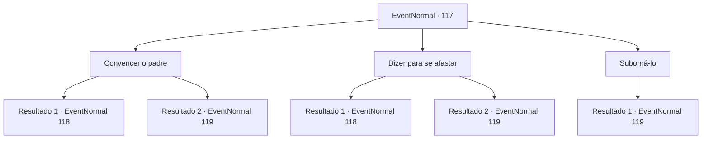

# Eventos normais · 117

[Índice da tabela](index.md) · [Índice geral](../index.md)

ID: `pt:EventNormal:117` · Fonte: `EventNormal4` · Versão: 1.2.47.

Mapeamento estático dos arquivos; a disponibilidade e a execução dependem do estado da run.

## Texto do evento

*Sem texto no arquivo.*

## Dados de entrada

```json
{
  "id": 117,
  "grade": 1,
  "place": "",
  "required": ""
}
```

## Mapa das escolhas



## Escolhas e resultados

### Escolha 1

Convencer o padre

Requisitos e outros campos da escolha:

```json
{
  "required": "1_7_9"
}
```

#### Resultado 1.1

Você tenta convencer o padre a recuar. Mas seu discurso áspero não consegue convencer ninguém. 

 "Em nome de Deus, purificarei esta terra de hereges e feras."


Continuação registrada: [Evento 118](0118.md) na mesma tabela.

```json
{
  "required": "",
  "chance": "14",
  "nextEvent": 118,
  "type": 1,
  "reward": "6_0_38",
  "place": 4
}
```

#### Resultado 1.2

Você o convence com sua lógica impecável. Ele acena com a cabeça e se afasta de você e de Rome. Rome olha para você e fala. 

 "Eu... não posso mais viver assim... deixe-me morrer, por favor..."

 De repente você se lembra que os vampiros são noturnos. Em outras palavras, ele está mergulhado até o pescoço em seu próprio sentimento noturno. A exposição prolongada à luz solar também não está ajudando.

Continuação registrada: [Evento 119](0119.md) na mesma tabela.

```json
{
  "required": "",
  "chance": "1|0_7_1",
  "nextEvent": 119,
  "type": 0,
  "reward": ""
}
```

### Escolha 2

Dizer para se afastar

Requisitos e outros campos da escolha:

```json
{
  "required": ""
}
```

#### Resultado 2.1

Você ameaça o padre para fazê-lo recuar. Ele balança a cabeça e continua. 

 "Então o diabo levou sua alma também. Em nome de Deus, purificarei esta terra de hereges e feras."


Continuação registrada: [Evento 118](0118.md) na mesma tabela.

```json
{
  "required": "",
  "chance": "11",
  "nextEvent": 118,
  "type": 1,
  "reward": "6_0_38",
  "place": 4
}
```

#### Resultado 2.2

Você o assusta com suas grandes palavras e gestos. Ele foge, gritando a plenos pulmões. Rome olha para você e fala. 

 "Eu... não posso mais viver assim... deixe-me morrer, por favor..."

 De repente você se lembra que os vampiros são noturnos. Em outras palavras, ele está mergulhado até o pescoço em seu próprio sentimento noturno. A exposição prolongada à luz solar também não está ajudando.

Continuação registrada: [Evento 119](0119.md) na mesma tabela.

```json
{
  "required": "",
  "chance": "1|0_12_1",
  "nextEvent": 119,
  "type": 0,
  "reward": ""
}
```

### Escolha 3

Suborná-lo

Requisitos e outros campos da escolha:

```json
{
  "required": "1_4_100"
}
```

#### Resultado 3.1

Você oferece a ele uma grande quantia de ouro. O padre olha em volta antes de pegar o ouro e responde: 

 "A-hem... Se você insiste, estou disposto a abrir uma exceção."

 Ele então se afasta de você e de Rome. Rome olha para você e fala. 

 "Eu... não posso mais viver assim... deixe-me morrer, por favor..."

 De repente você se lembra que os vampiros são noturnos. Em outras palavras, ele está mergulhado até o pescoço em seu próprio sentimento noturno. A exposição prolongada à luz solar também não está ajudando.

Continuação registrada: [Evento 119](0119.md) na mesma tabela.

```json
{
  "required": "",
  "chance": "1",
  "nextEvent": 119,
  "type": 2,
  "reward": ""
}
```

## Referências que chegam a este evento

- [Evento 116 · escolha 1 · resultado 1](0116.md#escolha-1)
