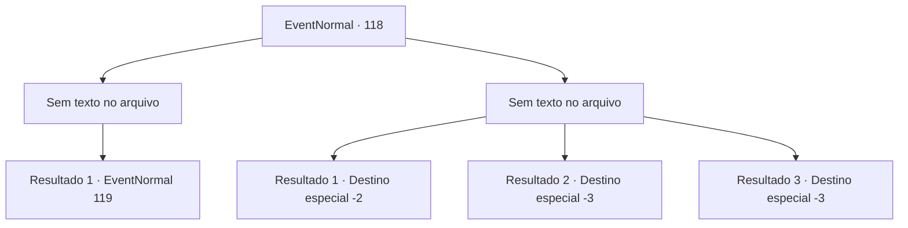

# Eventos normais · 118

[Índice da tabela](index.md) · [Índice geral](../index.md)

ID: `pt:EventNormal:118` · Fonte: `EventNormal4` · Versão: 1.2.47.

Mapeamento estático dos arquivos; a disponibilidade e a execução dependem do estado da run.

## Texto do evento

*Sem texto no arquivo.*

## Dados de entrada

```json
{
  "id": 118,
  "grade": 1,
  "place": "",
  "required": ""
}
```

## Mapa das escolhas



## Escolhas e resultados

### Escolha 1

*Sem texto no arquivo; o papel dessa opção depende da interface do jogo.*

Requisitos e outros campos da escolha:

```json
{
  "required": ""
}
```

#### Resultado 1.1

Ele foge, gritando a plenos pulmões. Rome olha para você e fala. 

 "Eu... não posso mais viver assim... deixe-me morrer, por favor..."

 De repente você se lembra que os vampiros são noturnos. Em outras palavras, ele está mergulhado até o pescoço em seu próprio sentimento noturno. A exposição prolongada à luz solar também não está ajudando.

Continuação registrada: [Evento 119](0119.md) na mesma tabela.

```json
{
  "required": "",
  "chance": "1",
  "nextEvent": 119,
  "type": 2,
  "reward": ""
}
```

### Escolha 2

*Sem texto no arquivo; o papel dessa opção depende da interface do jogo.*

Requisitos e outros campos da escolha:

```json
{
  "required": ""
}
```

#### Resultado 2.1

O padre te derruba com seu porrete. E então ele começa a matar Rome. O que restou dele instantaneamente se transforma em cinzas, e você não tem escolha a não ser fugir.

Continuação registrada: [Destino especial `-2`](../destinos-especiais.md).

```json
{
  "required": "1_0_2|1_1_2",
  "chance": "1",
  "nextEvent": -2,
  "type": 2,
  "reward": "0_0_-1|0_1_-1|5_47_6"
}
```

#### Resultado 2.2

O padre te deixa inconsciente com seu porrete.

Continuação registrada: [Destino especial `-3`](../destinos-especiais.md).

```json
{
  "required": "2_0_2",
  "chance": "1",
  "nextEvent": -3,
  "type": 2,
  "reward": "0_0_-1|0_1_-1"
}
```

#### Resultado 2.3

O padre te deixa inconsciente com seu porrete.

Continuação registrada: [Destino especial `-3`](../destinos-especiais.md).

```json
{
  "required": "2_1_2",
  "chance": "1",
  "nextEvent": -3,
  "type": 2,
  "reward": "0_0_-1|0_1_-1"
}
```

## Referências que chegam a este evento

- [Evento 117 · escolha 1 · resultado 1](0117.md#escolha-1)
- [Evento 117 · escolha 2 · resultado 1](0117.md#escolha-2)
