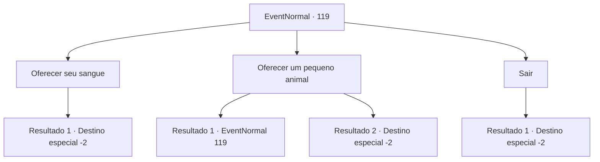

# Eventos normais · 119

[Índice da tabela](index.md) · [Índice geral](../index.md)

ID: `pt:EventNormal:119` · Fonte: `EventNormal4` · Versão: 1.2.47.

Mapeamento estático dos arquivos; a disponibilidade e a execução dependem do estado da run.

## Texto do evento

*Sem texto no arquivo.*

## Dados de entrada

```json
{
  "id": 119,
  "grade": 1,
  "place": "",
  "required": ""
}
```

## Mapa das escolhas



## Escolhas e resultados

### Escolha 1

Oferecer seu sangue

Requisitos e outros campos da escolha:

```json
{
  "required": "1_0_2"
}
```

#### Resultado 1.1

Você raspa uma pedra afiada em seu braço. A dor é seguida pelo sangue vermelho escorrendo. Você deixa Rome beber, o que ajuda a regenerar sua pele queimada. Ele está em lágrimas enquanto olha para você, quase recuperado. 

 "Por que... você faria... Mas obrigado..."

 Ele expressa desajeitadamente sua gratidão e lhe oferece seu colar. Em seguida, ele sai rapidamente. 

Continuação registrada: [Destino especial `-2`](../destinos-especiais.md).

```json
{
  "required": "",
  "chance": "1",
  "nextEvent": -2,
  "type": 2,
  "reward": "0_2_2|0_3_3|3_72_1|5_47_8|0_0_-1"
}
```

### Escolha 2

Oferecer um pequeno animal

Requisitos e outros campos da escolha:

```json
{
  "required": "5_74_0"
}
```

#### Resultado 2.1

Você vê um coelho, mas não consegue capturá-lo. Rome parece pior a cada segundo.

Continuação registrada: [Evento 119](0119.md) na mesma tabela.

```json
{
  "required": "",
  "chance": "10",
  "nextEvent": 119,
  "type": 1,
  "reward": "5_74_1"
}
```

#### Resultado 2.2

Você consegue prender um pequeno coelho. Usando uma pedra afiada, você abre sua barriga e deixa Rome beber seu sangue. Sua pele queimada se regenera a cada gole. Ele está em lágrimas enquanto olha para você, quase recuperado. 

 "Por que... você faria... Mas obrigado..."

 Ele expressa desajeitadamente sua gratidão e lhe oferece seu colar. Em seguida, ele sai rapidamente. 

Continuação registrada: [Destino especial `-2`](../destinos-especiais.md).

```json
{
  "required": "",
  "chance": "1|0_6_1",
  "nextEvent": -2,
  "type": 0,
  "reward": "0_2_2|0_3_1|3_72_1|5_47_8"
}
```

### Escolha 3

Sair

Requisitos e outros campos da escolha:

```json
{
  "required": ""
}
```

#### Resultado 3.1

Você percebe que não há muito o que fazer. Só o tempo vai realmente curar suas feridas. E com isso, você deixa Rome para trás e continua sua jornada.

Continuação registrada: [Destino especial `-2`](../destinos-especiais.md).

```json
{
  "required": "",
  "chance": "1",
  "nextEvent": -2,
  "type": 2,
  "reward": "5_47_6|0_2_1"
}
```

## Referências que chegam a este evento

- [Evento 117 · escolha 1 · resultado 2](0117.md#escolha-1)
- [Evento 117 · escolha 2 · resultado 2](0117.md#escolha-2)
- [Evento 117 · escolha 3 · resultado 1](0117.md#escolha-3)
- [Evento 118 · escolha 1 · resultado 1](0118.md#escolha-1)
- [Evento 119 · escolha 2 · resultado 1](0119.md#escolha-2)
