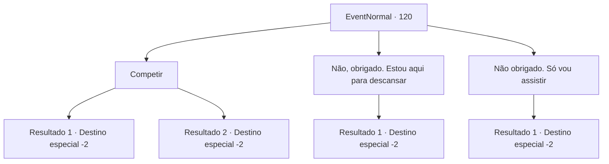

# Eventos normais · 120

[Índice da tabela](index.md) · [Índice geral](../index.md)

ID: `pt:EventNormal:120` · Fonte: `EventNormal4` · Versão: 1.2.47.

Mapeamento estático dos arquivos; a disponibilidade e a execução dependem do estado da run.

## Texto do evento

Você decide tirar seu cansaço em um pub local chamado 'Kiki's Bar'. Lá dentro, você encontra alcoólatras medianos desfrutando de suas bebidas. |drawing_drink| Os clientes são de todas as raças, incluindo anões, elfos, halflings e humanos. Todos estão bebendo como se não houvesse amanhã. Você os observa até que alguém na multidão fala com você. 

 "Tem interesse em competir, não é? É o Concurso Líder da Bebedeira! Quem bebe mais vence. O vencedor leva 50 de ouro em dinheiro! E claro, quem perder fica com uma ressaca terrível, haha!"


## Dados de entrada

```json
{
  "id": 120,
  "grade": 1,
  "place": "",
  "required": "5_75_0"
}
```

## Mapa das escolhas



## Escolhas e resultados

### Escolha 1

Competir

Requisitos e outros campos da escolha:

```json
{
  "required": "1_4_10"
}
```

#### Resultado 1.1

Você paga 10 de ouro para participar da diversão. O concurso de bebida começa. 
Uma cerveja, duas...
 
Dez canecas, onze...
 Você perde a conta e acorda no chão do pub com uma dor de cabeça terrível. Outros concorrentes também estão espalhados. O dono ri e diz que o vencedor já se foi com o prêmio em dinheiro.

Continuação registrada: [Destino especial `-2`](../destinos-especiais.md).

```json
{
  "required": "",
  "chance": "12",
  "nextEvent": -2,
  "type": 1,
  "reward": "0_4_-10|5_75_1|0_2_1"
}
```

#### Resultado 1.2

Você paga 10 de ouro para participar da diversão. O concurso de bebida começa. 
Uma cerveja, duas...
 
Dez canecas, onze...
 Você perde a conta, mas percebe que todos os outros concorrentes já estão bêbados. O proprietário aplaude e lhe entrega o prêmio em dinheiro. Então ele sussurra em seu ouvido. 

 "Caramba, você é um bêbado e tanto. Quer jogar uma rodada mais difícil?"

 Ele pede para que você compita nas semifinais.

Continuação registrada: [Destino especial `-2`](../destinos-especiais.md).

```json
{
  "required": "",
  "chance": "1|0_13_1",
  "nextEvent": -2,
  "type": 0,
  "reward": "0_2_1|0_4_50|5_75_2"
}
```

### Escolha 2

Não, obrigado. Estou aqui para descansar

Requisitos e outros campos da escolha:

```json
{
  "required": "1_4_10"
}
```

#### Resultado 2.1

Você sai da multidão e desfruta de sua bebida sozinho, em paz. Você fica agradavelmente bêbado.

Continuação registrada: [Destino especial `-2`](../destinos-especiais.md).

```json
{
  "required": "",
  "chance": "1",
  "nextEvent": -2,
  "type": 2,
  "reward": "0_1_1|0_4_-5|5_75_1|0_2_1"
}
```

### Escolha 3

Não obrigado. Só vou assistir

Requisitos e outros campos da escolha:

```json
{
  "required": ""
}
```

#### Resultado 3.1

Você assiste o resto do concurso se desenrolar. Os competidores ficam bêbados e começam a fazer uma cena. Você sai do bar antes que as coisas fiquem feias.

Continuação registrada: [Destino especial `-2`](../destinos-especiais.md).

```json
{
  "required": "",
  "chance": "1",
  "nextEvent": -2,
  "type": 2,
  "reward": "5_75_1"
}
```

## Referências que chegam a este evento

Nenhum `nextEvent` positivo da mesma tabela aponta para este nó. Isso não prova que seja inacessível: sorteio e estado de história podem selecioná-lo.

