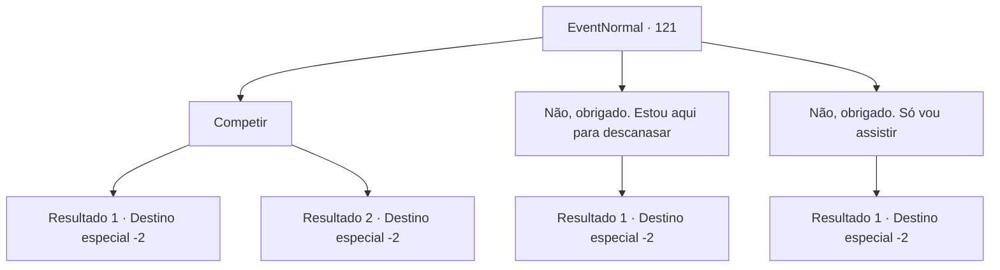

# Eventos normais · 121

[Índice da tabela](index.md) · [Índice geral](../index.md)

ID: `pt:EventNormal:121` · Fonte: `EventNormal4` · Versão: 1.2.47.

Mapeamento estático dos arquivos; a disponibilidade e a execução dependem do estado da run.

## Texto do evento

Você passa no 'Kiki's Bar', onde acontece o Concurso Líder da Bebedeira. O proprietário caminha até você e o cumprimenta. 

 "Ah, certo! Você também está nas semifinais. Entre!"

 Você o segue para dentro. Ele explica que a taxa de inscrição é de 20 ouros e o vencedor leva 100 ouros.

## Dados de entrada

```json
{
  "id": 121,
  "grade": 1,
  "place": "",
  "required": "5_75_2"
}
```

## Mapa das escolhas



## Escolhas e resultados

### Escolha 1

Competir

Requisitos e outros campos da escolha:

```json
{
  "required": "1_4_20"
}
```

#### Resultado 1.1

Você paga 20 de ouro para entrar. Começam as semifinais. 
Uma garrafa, duas...
 
Dez garrafas, onze...
 Você perde a conta e acorda no chão do pub com uma dor de cabeça terrível. Outros concorrentes também estão espalhados. O dono ri e diz que o vencedor já se foi com o prêmio em dinheiro.

Continuação registrada: [Destino especial `-2`](../destinos-especiais.md).

```json
{
  "required": "",
  "chance": "15",
  "nextEvent": -2,
  "type": 1,
  "reward": "5_75_3|0_4_-20|0_2_1"
}
```

#### Resultado 1.2

Você paga 20 de ouro para entrar. Começam as semifinais. 
Uma garrafa, duas...
 
Dez garrafas, onze...
 Você perde a conta, mas percebe que todos os outros concorrentes já estão bêbados. O proprietário aplaude e lhe entrega o prêmio em dinheiro. Então ele sussurra em seu ouvido. 

 "Agora você está classificado para as finais! Parabéns!"

 Ele pede para que você compita na rodada final.

Continuação registrada: [Destino especial `-2`](../destinos-especiais.md).

```json
{
  "required": "",
  "chance": "1|0_13_1",
  "nextEvent": -2,
  "type": 0,
  "reward": "0_2_1|0_4_100|5_75_4"
}
```

### Escolha 2

Não, obrigado. Estou aqui para descanasar

Requisitos e outros campos da escolha:

```json
{
  "required": "1_4_20"
}
```

#### Resultado 2.1

Você sai da multidão e desfruta de sua bebida sozinho, em paz. Você fica agradavelmente bêbado.

Continuação registrada: [Destino especial `-2`](../destinos-especiais.md).

```json
{
  "required": "",
  "chance": "1",
  "nextEvent": -2,
  "type": 2,
  "reward": "5_75_3|0_1_1|0_4_-5|0_2_1"
}
```

### Escolha 3

Não, obrigado. Só vou assistir

Requisitos e outros campos da escolha:

```json
{
  "required": ""
}
```

#### Resultado 3.1

Você assiste o resto do concurso se desenrolar. Os competidores ficam bêbados e começam a fazer uma cena. Você sai do bar antes que as coisas fiquem feias.

Continuação registrada: [Destino especial `-2`](../destinos-especiais.md).

```json
{
  "required": "",
  "chance": "1",
  "nextEvent": -2,
  "type": 2,
  "reward": "5_75_3"
}
```

## Referências que chegam a este evento

Nenhum `nextEvent` positivo da mesma tabela aponta para este nó. Isso não prova que seja inacessível: sorteio e estado de história podem selecioná-lo.

