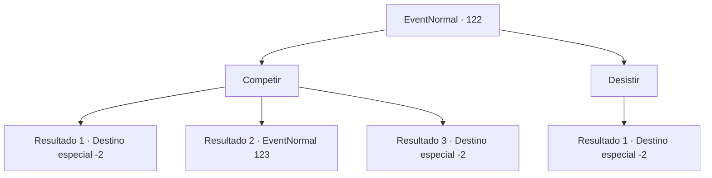

# Eventos normais · 122

[Índice da tabela](index.md) · [Índice geral](../index.md)

ID: `pt:EventNormal:122` · Fonte: `EventNormal4` · Versão: 1.2.47.

Mapeamento estático dos arquivos; a disponibilidade e a execução dependem do estado da run.

## Texto do evento

É a última noite antes da rodada final do Líder da Bebedeira.
 Depois de passar um tempo em uma pousada próxima, você retorna ao Kiki's Bar. Você não se aguenta de emoção para o confronto final de amanhã. 

 "Tudo bem, pessoal! Esta noite decidiremos quem é o maior bêbado ou a maior bêbada do continente!"

 Grita o proprietário e a multidão aplaude. A taxa de inscrição é de 50 ouros e o vencedor leva 200 ouros.

## Dados de entrada

```json
{
  "id": 122,
  "grade": 1,
  "place": "",
  "required": "5_75_4"
}
```

## Mapa das escolhas



## Escolhas e resultados

### Escolha 1

Competir

Requisitos e outros campos da escolha:

```json
{
  "required": "1_4_50"
}
```

#### Resultado 1.1

Você compete contra 3 outros bebedores de todo o continente. 
Uma garrafa, duas...
 
Dez garrafas, onze...
 
Um barril, dois barris...
 Você perde a conta e acorda no chão do pub com uma dor de cabeça terrível. Outros concorrentes também estão espalhados. O dono ri e diz que o vencedor já se foi com o prêmio em dinheiro.

Continuação registrada: [Destino especial `-2`](../destinos-especiais.md).

```json
{
  "required": "",
  "chance": "36",
  "nextEvent": -2,
  "type": 1,
  "reward": "5_75_5|0_4_-50|0_2_1"
}
```

#### Resultado 1.2

Você compete contra 3 outros bebedores de todo o continente. 
Uma garrafa, duas...
 
Dez garrafas, onze...
 
Um barril, dois barris...
 Você perde a conta, mas percebe que todos os outros concorrentes já estão bêbados. O proprietário aplaude e lhe entrega o prêmio em dinheiro. 

 "Parabéns! Você é oficialmente o maior bêbado deste continente!"

 Você aceita seu prêmio. De repente, um concorrente bêbado tropeça em sua direção. 

 "Seu... seu idiooootaaa!!"

 Ele insulta enquanto ergue o punho para você.

Continuação registrada: [Evento 123](0123.md) na mesma tabela.

```json
{
  "required": "",
  "chance": "1|0_13_1",
  "nextEvent": 123,
  "type": 0,
  "reward": "0_4_200|0_2_1|5_75_6|6_2_24",
  "place": 10
}
```

#### Resultado 1.3

Você compete contra 3 outros bebedores de todo o continente. 
Uma garrafa, duas...
 
Dez garrafas, onze...
 
Um barril, dois barris...
 Você perde a conta, mas percebe que todos os outros concorrentes já estão desperdiçados. O proprietário aplaude e lhe entrega o prêmio em dinheiro. 

 "Parabéns! Você é oficialmente o maior bêbado deste continente!"

 Você aceita seu prêmio. Um competidor bêbado tropeça em sua direção. 

 "Eu... admito... você é o melhooooor."

 Ele gagueja enquanto bate no chão. Você e o dono dão de ombros um para o outro antes de se separarem.

Continuação registrada: [Destino especial `-2`](../destinos-especiais.md).

```json
{
  "required": "",
  "chance": "1|0_13_1",
  "nextEvent": -2,
  "type": 0,
  "reward": "0_4_200|0_2_1|5_75_6"
}
```

### Escolha 2

Desistir

Requisitos e outros campos da escolha:

```json
{
  "required": ""
}
```

#### Resultado 2.1

Você anuncia a todos que não vai competir. O proprietário parece desapontado. Você sai do Kiki's Bar e continua sua jornada.

Continuação registrada: [Destino especial `-2`](../destinos-especiais.md).

```json
{
  "required": "",
  "chance": "1",
  "nextEvent": -2,
  "type": 2,
  "reward": "0_2_1|5_75_5"
}
```

## Referências que chegam a este evento

Nenhum `nextEvent` positivo da mesma tabela aponta para este nó. Isso não prova que seja inacessível: sorteio e estado de história podem selecioná-lo.

