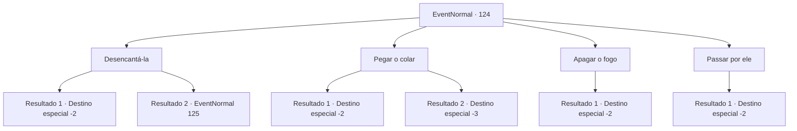

# Eventos normais · 124

[Índice da tabela](index.md) · [Índice geral](../index.md)

ID: `pt:EventNormal:124` · Fonte: `EventNormal4` · Versão: 1.2.47.

Mapeamento estático dos arquivos; a disponibilidade e a execução dependem do estado da run.

## Texto do evento


 "Cocka doodle-doo!"

 Você vê uma galinha correndo com o rabo em chamas. Ela está usando um colar estranho gravado com runas.

## Dados de entrada

```json
{
  "id": 124,
  "grade": 1,
  "place": "",
  "required": "2_2_50|5_81_0"
}
```

## Mapa das escolhas



## Escolhas e resultados

### Escolha 1

Desencantá-la

Requisitos e outros campos da escolha:

```json
{
  "required": ""
}
```

#### Resultado 1.1

Você percebe que o colar está amaldiçoado. Mas o feitiço por trás disso é muito complicado. O frango queima até ficar crocante antes que você possa fazer qualquer coisa. Você deixa a pequena pilha de cinzas para trás e segue em frente.

Continuação registrada: [Destino especial `-2`](../destinos-especiais.md).

```json
{
  "required": "",
  "chance": "12",
  "nextEvent": -2,
  "type": 1,
  "reward": "0_2_1"
}
```

#### Resultado 1.2

Você percebe que o colar está amaldiçoado. Após ponderar um pouco, você desencanta com sucesso o colar. As chamas na cauda da galinha desaparecem. 

 "Doodle... do?"

 A galinha verifica sua traseira e bate as asas alegremente. Então ela gesticula para você segui-la.

Continuação registrada: [Evento 125](0125.md) na mesma tabela.

```json
{
  "required": "",
  "chance": "1|0_7_1",
  "nextEvent": 125,
  "type": 0,
  "reward": "5_81_9"
}
```

### Escolha 2

Pegar o colar

Requisitos e outros campos da escolha:

```json
{
  "required": ""
}
```

#### Resultado 2.1

Você tenta levantar o colar da galinha. Mas ele não se move, e as chamas engolem suas mãos. Você consegue apagar o fogo em suas mãos, mas o frango queima até ficar crocante antes que você possa fazer qualquer coisa. Você percebe que o colar está amaldiçoado.

Continuação registrada: [Destino especial `-2`](../destinos-especiais.md).

```json
{
  "required": "1_0_2",
  "chance": "1",
  "nextEvent": -2,
  "type": 2,
  "reward": "0_2_1|0_3_1|0_0_-1"
}
```

#### Resultado 2.2

Você tenta levantar o colar da galinha. Mas ele não se move, e as chamas engolem suas mãos. O fogo queima vocês dois até ficarem crocantes.

Continuação registrada: [Destino especial `-3`](../destinos-especiais.md).

```json
{
  "required": "2_0_2",
  "chance": "1",
  "nextEvent": -3,
  "type": 2,
  "reward": "0_0_-1"
}
```

### Escolha 3

Apagar o fogo

Requisitos e outros campos da escolha:

```json
{
  "required": ""
}
```

#### Resultado 3.1

Você tenta de várias formas para apagar o fogo. Você joga terra sobre o frango e tenta mergulhá-lo no rio. Mas as chamas simplesmente aumentam, queimando o frango até ficar crocante. Você deixa a pequena pilha de cinzas para trás e segue em frente.

Continuação registrada: [Destino especial `-2`](../destinos-especiais.md).

```json
{
  "required": "",
  "chance": "1",
  "nextEvent": -2,
  "type": 2,
  "reward": "0_3_1"
}
```

### Escolha 4

Passar por ele

Requisitos e outros campos da escolha:

```json
{
  "required": ""
}
```

#### Resultado 4.1

Você passa pela galinha em chamas. Seus gritos se tornam um eco à medida que você se afasta.

Continuação registrada: [Destino especial `-2`](../destinos-especiais.md).

```json
{
  "required": "",
  "chance": "1",
  "nextEvent": -2,
  "type": 2,
  "reward": "0_3_-1"
}
```

## Referências que chegam a este evento

Nenhum `nextEvent` positivo da mesma tabela aponta para este nó. Isso não prova que seja inacessível: sorteio e estado de história podem selecioná-lo.

