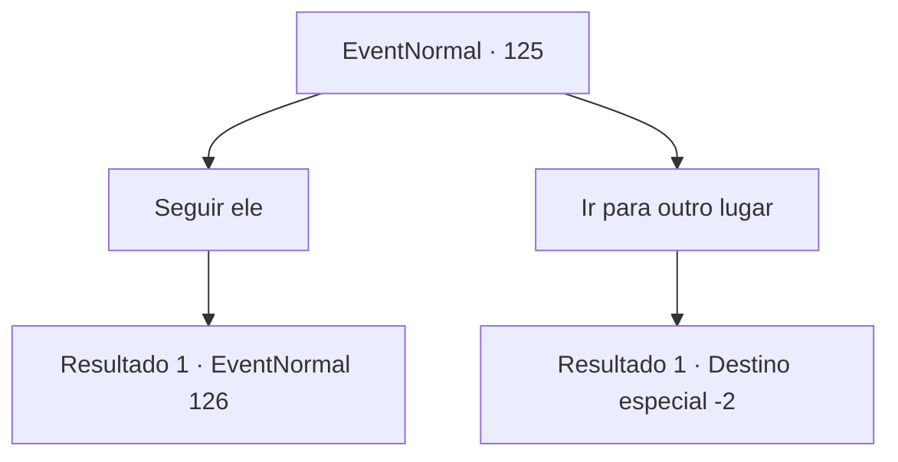

# Eventos normais · 125

[Índice da tabela](index.md) · [Índice geral](../index.md)

ID: `pt:EventNormal:125` · Fonte: `EventNormal4` · Versão: 1.2.47.

Mapeamento estático dos arquivos; a disponibilidade e a execução dependem do estado da run.

## Texto do evento

*Sem texto no arquivo.*

## Dados de entrada

```json
{
  "id": 125,
  "grade": 1,
  "place": "",
  "required": ""
}
```

## Mapa das escolhas



## Escolhas e resultados

### Escolha 1

Seguir ele

Requisitos e outros campos da escolha:

```json
{
  "required": ""
}
```

#### Resultado 1.1

Você segue a galinha.
 Vocês dois atravessam uma planície ampla e chegam à frente de uma cabana em ruínas. A casa é cercada por inúmeras galinhas comendo e tomando banho de sol. Um jovem vê você. Parece ser o dono. 

 "Onde você esteve, Shawny? O que aconteceu com sua cauda?"

 Ele cumprimenta sua galinha e a inspeciona. Então ele vê o colar estranho e pergunta o que aconteceu. Você explica que a galinha estava pegando fogo e que você apagou. 

 "Entendo... muito obrigado! Acho que sei quem fez isso. Você poderia, por favor, me dar uma mão?"


Continuação registrada: [Evento 126](0126.md) na mesma tabela.

```json
{
  "required": "",
  "chance": "1",
  "nextEvent": 126,
  "type": 2,
  "reward": ""
}
```

### Escolha 2

Ir para outro lugar

Requisitos e outros campos da escolha:

```json
{
  "required": ""
}
```

#### Resultado 2.1

Você escolhe não seguir a galinha.

Continuação registrada: [Destino especial `-2`](../destinos-especiais.md).

```json
{
  "required": "",
  "chance": "1",
  "nextEvent": -2,
  "type": 2,
  "reward": ""
}
```

## Referências que chegam a este evento

- [Evento 124 · escolha 1 · resultado 2](0124.md#escolha-1)
