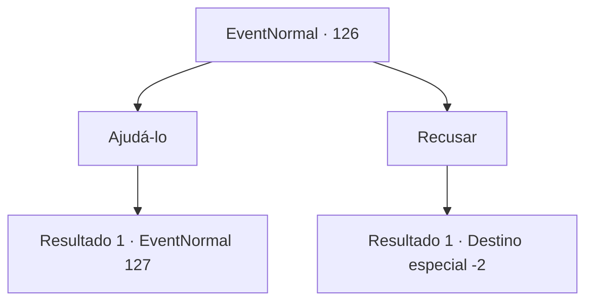

# Eventos normais · 126

[Índice da tabela](index.md) · [Índice geral](../index.md)

ID: `pt:EventNormal:126` · Fonte: `EventNormal4` · Versão: 1.2.47.

Mapeamento estático dos arquivos; a disponibilidade e a execução dependem do estado da run.

## Texto do evento

*Sem texto no arquivo.*

## Dados de entrada

```json
{
  "id": 126,
  "grade": 1,
  "place": "",
  "required": ""
}
```

## Mapa das escolhas



## Escolhas e resultados

### Escolha 1

Ajudá-lo

Requisitos e outros campos da escolha:

```json
{
  "required": ""
}
```

#### Resultado 1.1

O homem percebe que não se apresentou e logo o faz. Ele é Harold e é dono de uma granja. Ele suspeita de uma anciã chamada Breva com base no colar. 

 "Ela é uma druida, sabe. Suas especialidades incluem ervas, feitiços e maldições. Essas runas, devem ser coisa dela."

 No entanto, ele não entende por que Breva faria tal coisa com Shawny especificamente. De qualquer forma, você concorda em visitar a idosa. 

 Você caminha até a vila e encontra Breva. Ela está sentada em uma cadeira de balanço do lado de fora da casa, olhando para longe com seus olhos opacos. 

 "O que te traz aqui...?"


Continuação registrada: [Evento 127](0127.md) na mesma tabela.

```json
{
  "required": "",
  "chance": "1",
  "nextEvent": 127,
  "type": 2,
  "reward": ""
}
```

### Escolha 2

Recusar

Requisitos e outros campos da escolha:

```json
{
  "required": ""
}
```

#### Resultado 2.1

Você se recusa a ajudar o jovem. Ele parece desapontado, mas mesmo assim lhe entrega um pouco de ouro. 

 "Isso é por salvar Shawny. Que Deus te abençoe onde quer que você vá."

 Você pega o ouro e sai da fazenda.

Continuação registrada: [Destino especial `-2`](../destinos-especiais.md).

```json
{
  "required": "",
  "chance": "1",
  "nextEvent": -2,
  "type": 2,
  "reward": "0_4_20|0_2_1"
}
```

## Referências que chegam a este evento

- [Evento 125 · escolha 1 · resultado 1](0125.md#escolha-1)
