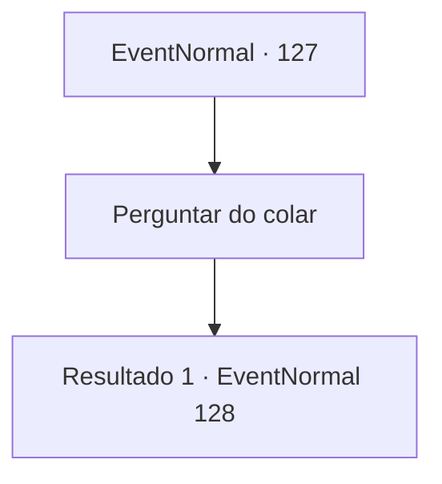

# Eventos normais · 127

[Índice da tabela](index.md) · [Índice geral](../index.md)

ID: `pt:EventNormal:127` · Fonte: `EventNormal4` · Versão: 1.2.47.

Mapeamento estático dos arquivos; a disponibilidade e a execução dependem do estado da run.

## Texto do evento

*Sem texto no arquivo.*

## Dados de entrada

```json
{
  "id": 127,
  "grade": 1,
  "place": "",
  "required": ""
}
```

## Mapa das escolhas



## Escolhas e resultados

### Escolha 1

Perguntar do colar

Requisitos e outros campos da escolha:

```json
{
  "required": ""
}
```

#### Resultado 1.1

Você mostra a ela o colar esculpido em runas e pergunta se parece familiar. Ela assente e explica. 

 "Eu uso isso quando eu cozinho. Chama-se anel de fogo. Eu estava me perguntando onde isso tinha ido parar. Obrigada por me devolver."


Continuação registrada: [Evento 128](0128.md) na mesma tabela.

```json
{
  "required": "",
  "chance": "1",
  "nextEvent": 128,
  "type": 2,
  "reward": ""
}
```

## Referências que chegam a este evento

- [Evento 126 · escolha 1 · resultado 1](0126.md#escolha-1)
