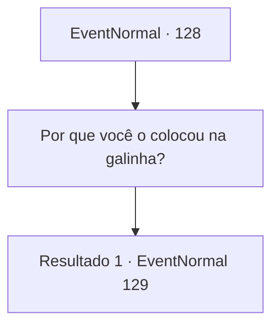

# Eventos normais · 128

[Índice da tabela](index.md) · [Índice geral](../index.md)

ID: `pt:EventNormal:128` · Fonte: `EventNormal4` · Versão: 1.2.47.

Mapeamento estático dos arquivos; a disponibilidade e a execução dependem do estado da run.

## Texto do evento

*Sem texto no arquivo.*

## Dados de entrada

```json
{
  "id": 128,
  "grade": 1,
  "place": "",
  "required": ""
}
```

## Mapa das escolhas



## Escolhas e resultados

### Escolha 1

Por que você o colocou na galinha?

Requisitos e outros campos da escolha:

```json
{
  "required": ""
}
```

#### Resultado 1.1

Você pergunta a ela por que ela fez a galinha de Harold usar o colar. A anciã parece confusa ao responder. 

 "O que...? Já te disse, não é um colar, não é para maldições. É um aparelho de cozinha. Por que eu faria..."

 Então ela abre a janela e chama por Bera. Um menino de 10 anos corre em direção a Breva. Ela pergunta ao garoto em voz baixa. 

 "Bera. Você pegou alguma coisa da minha cozinha? Você pegou o anel de fogo?"

 Bera balança a cabeça.

Continuação registrada: [Evento 129](0129.md) na mesma tabela.

```json
{
  "required": "",
  "chance": "1",
  "nextEvent": 129,
  "type": 2,
  "reward": ""
}
```

## Referências que chegam a este evento

- [Evento 127 · escolha 1 · resultado 1](0127.md#escolha-1)
