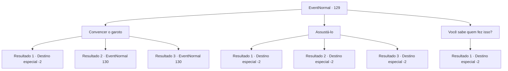

# Eventos normais · 129

[Índice da tabela](index.md) · [Índice geral](../index.md)

ID: `pt:EventNormal:129` · Fonte: `EventNormal4` · Versão: 1.2.47.

Mapeamento estático dos arquivos; a disponibilidade e a execução dependem do estado da run.

## Texto do evento

*Sem texto no arquivo.*

## Dados de entrada

```json
{
  "id": 129,
  "grade": 1,
  "place": "",
  "required": ""
}
```

## Mapa das escolhas



## Escolhas e resultados

### Escolha 1

Convencer o garoto

Requisitos e outros campos da escolha:

```json
{
  "required": "1_7_10"
}
```

#### Resultado 1.1

Você percebe que Bera está mentindo, e gentilmente tente fazê-lo confessar. Mas o pirralho te ignora e corre de volta para dentro. Breva suspira enquanto fala com você. 

 "Huh... eu não sei quem fez isso, mas com certeza não foi meu neto. Diga ao jovem da fazenda que não fui eu e nem ele."

 Ela se levanta da cadeira de balanço e entra. 

 Você volta para o Harold e conta a ele o que aconteceu. Ele pede desculpas por fazer você executar uma tarefa vazia e lhe entrega um pouco de ouro. Você pega e continua sua aventura.

Continuação registrada: [Destino especial `-2`](../destinos-especiais.md).

```json
{
  "required": "",
  "chance": "14",
  "nextEvent": -2,
  "type": 1,
  "reward": "0_3_1|0_4_10|0_2_1"
}
```

#### Resultado 1.2

Os olhos da garota se arregalam enquanto ela grita em descrença. 

 "O que?? Por que você..."

 A menina entrega a você seu cesto de fósforos com as mãos trêmulas, e se curva em gratidão, de modo que sua cabeça quase toca o chão. Então ela desaparece.

Continuação registrada: [Evento 130](0130.md) na mesma tabela.

```json
{
  "required": "21_4_2",
  "chance": "1|0_14_1",
  "nextEvent": 130,
  "type": 0,
  "reward": "3_137_1"
}
```

#### Resultado 1.3

Você percebe que Bera está mentindo, e comece a falar com ele no seu tom carismático. Eventualmente, ele confessa que fez isso. 

 "Aquela galinha estava intimidando a nossa galinha..."

 Breva suspira enquanto fala com você. 

 "Ufa... acho que devo desculpas àquele jovem da fazenda. Aqui... Leve isso para ele."

 Ela lhe entrega uma cesta de batatas. Você volta para a fazenda, pronto para contar a verdade a Harold.

Continuação registrada: [Evento 130](0130.md) na mesma tabela.

```json
{
  "required": "20_4_2",
  "chance": "1|0_14_2",
  "nextEvent": 130,
  "type": 0,
  "reward": "3_137_1"
}
```

### Escolha 2

Assustá-lo

Requisitos e outros campos da escolha:

```json
{
  "required": "1_7_10"
}
```

#### Resultado 2.1

Você percebe que Bera está mentindo e tenta ameaçá-lo. Mas o pirralho te ignora e corre de volta para dentro. Breva suspira enquanto fala com você. 

 "Huh... eu não sei quem fez isso, mas com certeza não foi meu neto. Diga ao jovem da fazenda que não fui eu e nem ele."

 Ela se levanta da cadeira de balanço e entra. 

 Você volta para Harold e conta a ele o que aconteceu. Ele pede desculpas por fazer você executar uma tarefa vazia e lhe entrega um pouco de ouro. Você pega e continua sua aventura.

Continuação registrada: [Destino especial `-2`](../destinos-especiais.md).

```json
{
  "required": "",
  "chance": "10",
  "nextEvent": -2,
  "type": 1,
  "reward": "0_3_1|0_4_10|0_2_1"
}
```

#### Resultado 2.2

Você percebe que Bera está mentindo e começa a ameaçá-lo. O garoto se encolhe e começa a falar. 

 "Eu, uh... mas aquela galinha estava intimidando a nossa galinha..."

 Então ele começa a chorar, e Breva grita com você por fazê-lo chorar. De qualquer forma, você descobriu quem fez isso. Você volta para a fazenda, pronto para contar a verdade a Harold. 

 Haroldo agradece, e lhe entrega um ovo brilhante incomum em troca. 

 "Obrigado, aventureiro. Eu vou falar com o garoto."

 Você pega o ovo e continua sua aventura.

Continuação registrada: [Destino especial `-2`](../destinos-especiais.md).

```json
{
  "required": "21_1_2",
  "chance": "1|0_12_1",
  "nextEvent": -2,
  "type": 0,
  "reward": "0_3_-1|0_2_1|3_138_1|5_81_1"
}
```

#### Resultado 2.3

Você percebe que Bera está mentindo e começa a ameaçá-lo. O garoto se encolhe e começa a falar. 

 "Eu, uh... mas aquela galinha estava intimidando a nossa galinha..."

 Então ele começa a chorar, e Breva grita com você por fazê-lo chorar. De qualquer forma, você descobriu quem fez isso. Você volta para a fazenda, pronto para contar a verdade a Harold. 

 Haroldo agradece, e lhe entrega um ovo brilhante incomum em troca. 

 "Obrigado, aventureiro. Este é o ovo de Shawny, por favor, pegue-o. Eu vou falar com aquela criança travessa."

 Você pega o ovo e continua sua aventura.

Continuação registrada: [Destino especial `-2`](../destinos-especiais.md).

```json
{
  "required": "20_1_2",
  "chance": "1|0_12_2",
  "nextEvent": -2,
  "type": 0,
  "reward": "0_3_3|3_138_1|0_2_2|5_81_1"
}
```

### Escolha 3

Você sabe quem fez isso?

Requisitos e outros campos da escolha:

```json
{
  "required": ""
}
```

#### Resultado 3.1

O garoto te olha direto nos olhos e responde que não. Então ele volta para dentro. Breva suspira enquanto fala com você. 

 "Huh... eu não sei quem fez isso, mas com certeza não foi meu neto. Diga ao jovem da fazenda que não fui eu e nem ele."

 Ela se levanta da cadeira de balanço e entra. 

 Você volta para Harold e conta a ele o que aconteceu. Ele pede desculpas por fazer você executar uma tarefa vazia e lhe entrega um pouco de ouro. Você pega e continua sua aventura.

Continuação registrada: [Destino especial `-2`](../destinos-especiais.md).

```json
{
  "required": "",
  "chance": "1",
  "nextEvent": -2,
  "type": 2,
  "reward": "0_4_10|0_2_1"
}
```

## Referências que chegam a este evento

- [Evento 128 · escolha 1 · resultado 1](0128.md#escolha-1)
