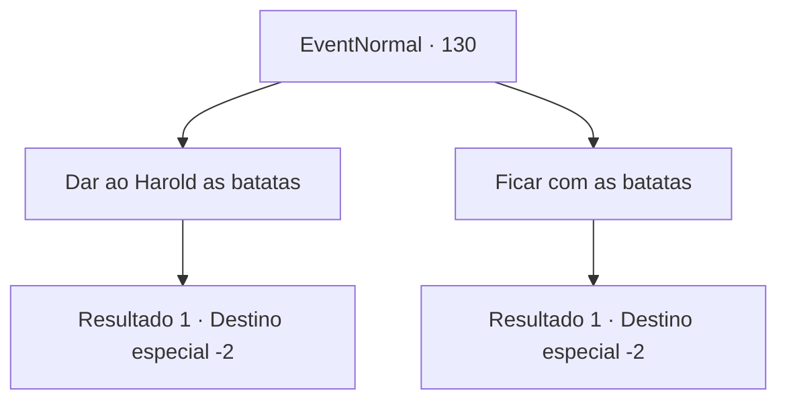

# Eventos normais · 130

[Índice da tabela](index.md) · [Índice geral](../index.md)

ID: `pt:EventNormal:130` · Fonte: `EventNormal4` · Versão: 1.2.47.

Mapeamento estático dos arquivos; a disponibilidade e a execução dependem do estado da run.

## Texto do evento

*Sem texto no arquivo.*

## Dados de entrada

```json
{
  "id": 130,
  "grade": 1,
  "place": "",
  "required": ""
}
```

## Mapa das escolhas



## Escolhas e resultados

### Escolha 1

Dar ao Harold as batatas

Requisitos e outros campos da escolha:

```json
{
  "required": "8_137_1"
}
```

#### Resultado 1.1

Você volta a subir a colina até a granja do Harold. Ele está alimentando suas galinhas. Harold agradece a informação e as batatas de Breva. Ele lhe entrega um ovo brilhante incomum em troca. 

 "Obrigado, aventureiro. Este é o ovo de Shawny, por favor, pegue-o. Vou pedir desculpas à anciã."

 Você pega o ovo e continua sua aventura.

Continuação registrada: [Destino especial `-2`](../destinos-especiais.md).

```json
{
  "required": "",
  "chance": "1",
  "nextEvent": -2,
  "type": 2,
  "reward": "4_137_1|0_3_3|3_138_1|0_2_2|5_81_1"
}
```

### Escolha 2

Ficar com as batatas

Requisitos e outros campos da escolha:

```json
{
  "required": ""
}
```

#### Resultado 2.1

Você volta a subir a colina até a granja de Harold. Ele está alimentando suas galinhas. Haroldo agradece a informação. Ele lhe entrega um ovo brilhante incomum em troca. 

 "Obrigado, aventureiro. Este é o ovo de Shawny, por favor, pegue-o. Eu vou falar com aquela criança travessa"

 Você pega o ovo e continua sua aventura.

Continuação registrada: [Destino especial `-2`](../destinos-especiais.md).

```json
{
  "required": "",
  "chance": "1",
  "nextEvent": -2,
  "type": 2,
  "reward": "3_138_1|0_2_2|5_81_1"
}
```

## Referências que chegam a este evento

- [Evento 129 · escolha 1 · resultado 2](0129.md#escolha-1)
- [Evento 129 · escolha 1 · resultado 3](0129.md#escolha-1)
