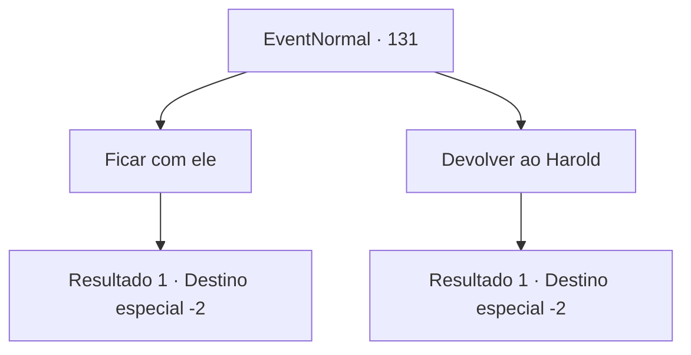

# Eventos normais · 131

[Índice da tabela](index.md) · [Índice geral](../index.md)

ID: `pt:EventNormal:131` · Fonte: `EventNormal4` · Versão: 1.2.47.

Mapeamento estático dos arquivos; a disponibilidade e a execução dependem do estado da run.

## Texto do evento

Você percebe que algo está se contorcendo em sua mochila. Você abre a bolsa e encontra um filhotinho vermelho. O ovo do Harold deve ter chocado. O passarinho fofo parece pensar que você é a mãe dele.

## Dados de entrada

```json
{
  "id": 131,
  "grade": 2,
  "place": "",
  "required": "1_2_25|8_138_1|5_81_1"
}
```

## Mapa das escolhas



## Escolhas e resultados

### Escolha 1

Ficar com ele

Requisitos e outros campos da escolha:

```json
{
  "required": ""
}
```

#### Resultado 1.1

Você alimenta o pássaro com um pouco de sua comida e acaricia sua pequena cabeça com o dedo. Então você o coloca de volta dentro da bolsa. Como sua mãe se chama Shawny, você decide chamá-la de Shawna. Vocês dois continuam sua jornada.

Continuação registrada: [Destino especial `-2`](../destinos-especiais.md).

```json
{
  "required": "",
  "chance": "1",
  "nextEvent": -2,
  "type": 2,
  "reward": "4_138_1|3_139_1|5_81_2"
}
```

### Escolha 2

Devolver ao Harold

Requisitos e outros campos da escolha:

```json
{
  "required": ""
}
```

#### Resultado 2.1

Você decide devolver o pintinho para a granja de Harold. Será melhor com sua verdadeira mãe.

Continuação registrada: [Destino especial `-2`](../destinos-especiais.md).

```json
{
  "required": "",
  "chance": "1",
  "nextEvent": -2,
  "type": 2,
  "reward": "5_81_3|4_138_1|3_139_1"
}
```

## Referências que chegam a este evento

Nenhum `nextEvent` positivo da mesma tabela aponta para este nó. Isso não prova que seja inacessível: sorteio e estado de história podem selecioná-lo.

