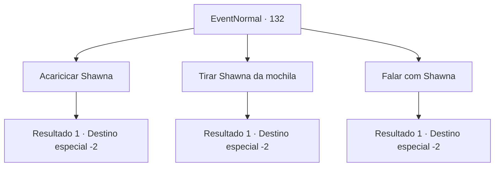

# Eventos normais · 132

[Índice da tabela](index.md) · [Índice geral](../index.md)

ID: `pt:EventNormal:132` · Fonte: `EventNormal4` · Versão: 1.2.47.

Mapeamento estático dos arquivos; a disponibilidade e a execução dependem do estado da run.

## Texto do evento

Shawna se transforma em uma galinha vermelha brilhante com o seu cuidado. O corpo do pássaro está muito quente. Shawna cutuca sua mochila, virando a cabeça para a esquerda e para a direita.

## Dados de entrada

```json
{
  "id": 132,
  "grade": 2,
  "place": "",
  "required": "1_2_40|8_139_1|5_81_2"
}
```

## Mapa das escolhas



## Escolhas e resultados

### Escolha 1

Acaricicar Shawna

Requisitos e outros campos da escolha:

```json
{
  "required": ""
}
```

#### Resultado 1.1

Você acaricia a cabeça de Shawna com a mão. O frango esfrega agradavelmente contra a palma da mão. Então o pássaro desliza de volta para dentro.

Continuação registrada: [Destino especial `-2`](../destinos-especiais.md).

```json
{
  "required": "",
  "chance": "1",
  "nextEvent": -2,
  "type": 2,
  "reward": "4_139_1|3_140_1|5_81_9"
}
```

### Escolha 2

Tirar Shawna da mochila

Requisitos e outros campos da escolha:

```json
{
  "required": ""
}
```

#### Resultado 2.1

Você tira Shawna de sua mochila. A grande galinha pousa no chão com um carisma incomum na maioria das outras. Em seguida, o pássaro pega e engole um verme. Você começa a caminhar de novo, e Shawna lhe acompanha.

Continuação registrada: [Destino especial `-2`](../destinos-especiais.md).

```json
{
  "required": "",
  "chance": "1",
  "nextEvent": -2,
  "type": 2,
  "reward": "4_139_1|3_140_1|5_81_9"
}
```

### Escolha 3

Falar com Shawna

Requisitos e outros campos da escolha:

```json
{
  "required": ""
}
```

#### Resultado 3.1

Você tenta falar com Shawna. 

 "Pluck... p-pluck?"

 Mas a galinha é mesmo apenas uma galinha, incapaz de entender suas palavras. Shawna desliza de volta para dentro.

Continuação registrada: [Destino especial `-2`](../destinos-especiais.md).

```json
{
  "required": "",
  "chance": "1",
  "nextEvent": -2,
  "type": 2,
  "reward": "4_139_1|3_140_1|5_81_9"
}
```

## Referências que chegam a este evento

Nenhum `nextEvent` positivo da mesma tabela aponta para este nó. Isso não prova que seja inacessível: sorteio e estado de história podem selecioná-lo.

