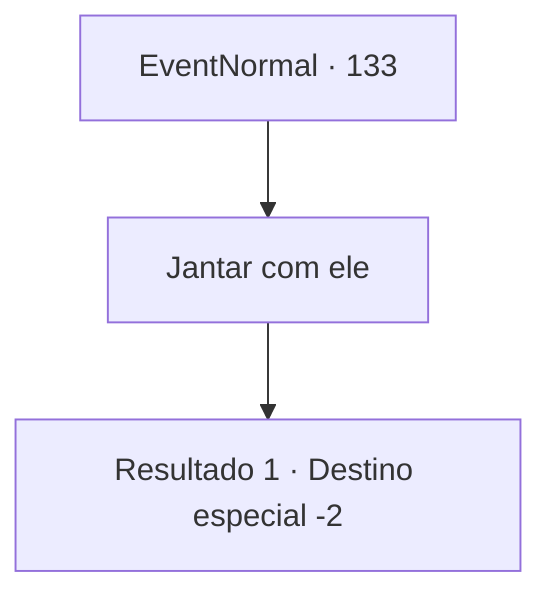

# Eventos normais · 133

[Índice da tabela](index.md) · [Índice geral](../index.md)

ID: `pt:EventNormal:133` · Fonte: `EventNormal4` · Versão: 1.2.47.

Mapeamento estático dos arquivos; a disponibilidade e a execução dependem do estado da run.

## Texto do evento

Você passa pela fazenda de galinhas do Harold novamente. Você entrega o filhotinho para o Harold. Ele se recusa várias vezes, mas acaba pegando o filhote. 

 "Obrigado, aventureiro... Eu, uh, não tenho muito a oferecer, mas posso preparar uma refeição decente para você, se quiser."


## Dados de entrada

```json
{
  "id": 133,
  "grade": 2,
  "place": "",
  "required": "1_2_40|8_139_1|5_81_3"
}
```

## Mapa das escolhas



## Escolhas e resultados

### Escolha 1

Jantar com ele

Requisitos e outros campos da escolha:

```json
{
  "required": ""
}
```

#### Resultado 1.1

Harold cozinha um pouco de comida para você. Você desfruta de muitos pratos de ovos diferentes e descansa antes de continuar sua jornada.

Continuação registrada: [Destino especial `-2`](../destinos-especiais.md).

```json
{
  "required": "",
  "chance": "1",
  "nextEvent": -2,
  "type": 2,
  "reward": "4_139_1|0_0_1|0_1_1|0_2_1|5_81_9"
}
```

## Referências que chegam a este evento

Nenhum `nextEvent` positivo da mesma tabela aponta para este nó. Isso não prova que seja inacessível: sorteio e estado de história podem selecioná-lo.

