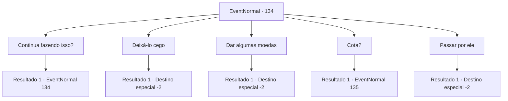

# Eventos normais · 134

[Índice da tabela](index.md) · [Índice geral](../index.md)

ID: `pt:EventNormal:134` · Fonte: `EventNormal4` · Versão: 1.2.47.

Mapeamento estático dos arquivos; a disponibilidade e a execução dependem do estado da run.

## Texto do evento

|drawing_begger| Você encontra aquele mendigo falso-cego de novo. Ele usa o mesmo truque com você novamente ao pedir dinheiro. 

 "Alguém ajude esta pobre alma cega!"


## Dados de entrada

```json
{
  "id": 134,
  "grade": 1,
  "place": "",
  "required": "5_7_1"
}
```

## Mapa das escolhas



## Escolhas e resultados

### Escolha 1

Continua fazendo isso?

Requisitos e outros campos da escolha:

```json
{
  "required": "5_7_1"
}
```

#### Resultado 1.1

Você pergunta ao mendigo, e ele pula para trás. Então ele pergunta com uma voz trêmula. 

 "Nós... nos conhecemos?"

 Ele continua falando antes que você possa responder. 

 "Por favor, por favor, apenas me ignore... Eu preciso cumprir minha cota..."


Continuação registrada: [Evento 134](0134.md) na mesma tabela.

```json
{
  "required": "",
  "chance": "1",
  "nextEvent": 134,
  "type": 2,
  "reward": "5_7_2"
}
```

### Escolha 2

Deixá-lo cego

Requisitos e outros campos da escolha:

```json
{
  "required": "2_3_0"
}
```

#### Resultado 2.1

Você decide fazer desse impostor um verdadeiro cego. Você saca sua arma e apunhala o mendigo nos olhos. <color=red><link=shake>

 "GRAAAAH! Seu... maluco... GRRRGH!"

</link></color> Ele gorgoleja e rola de dor antes de desmaiar. Você sai de cena antes que alguém te veja.

Continuação registrada: [Destino especial `-2`](../destinos-especiais.md).

```json
{
  "required": "",
  "chance": "1",
  "nextEvent": -2,
  "type": 2,
  "reward": "5_7_9|0_3_-5|0_2_1"
}
```

### Escolha 3

Dar algumas moedas

Requisitos e outros campos da escolha:

```json
{
  "required": "1_4_2"
}
```

#### Resultado 3.1

Você entrega algumas moedas ao mendigo apesar de saber que sua cegueira é falsa. Ele se curva repetidamente enquanto lhe agradece. 

 "Obrigado, muito obrigado."

 Você o deixa para trás e segue em frente.

Continuação registrada: [Destino especial `-2`](../destinos-especiais.md).

```json
{
  "required": "",
  "chance": "1",
  "nextEvent": -2,
  "type": 2,
  "reward": "0_4_-2|0_3_1|0_2_1"
}
```

### Escolha 4

Cota?

Requisitos e outros campos da escolha:

```json
{
  "required": "5_7_2"
}
```

#### Resultado 4.1

O mendigo cobre a boca e balança a cabeça violentamente. Ele diz que tudo isso é um erro e que você deve ir embora.

Continuação registrada: [Evento 135](0135.md) na mesma tabela.

```json
{
  "required": "",
  "chance": "1",
  "nextEvent": 135,
  "type": 2,
  "reward": "5_7_3"
}
```

### Escolha 5

Passar por ele

Requisitos e outros campos da escolha:

```json
{
  "required": ""
}
```

#### Resultado 5.1

Você passa pelo mendigo falso-cego e continua.

Continuação registrada: [Destino especial `-2`](../destinos-especiais.md).

```json
{
  "required": "",
  "chance": "1",
  "nextEvent": -2,
  "type": 2,
  "reward": ""
}
```

## Referências que chegam a este evento

- [Evento 134 · escolha 1 · resultado 1](0134.md#escolha-1)
