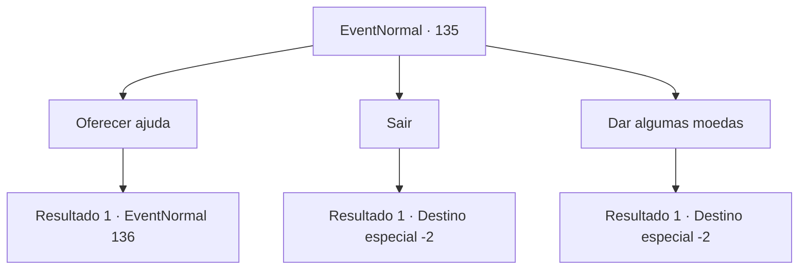

# Eventos normais · 135

[Índice da tabela](index.md) · [Índice geral](../index.md)

ID: `pt:EventNormal:135` · Fonte: `EventNormal4` · Versão: 1.2.47.

Mapeamento estático dos arquivos; a disponibilidade e a execução dependem do estado da run.

## Texto do evento

*Sem texto no arquivo.*

## Dados de entrada

```json
{
  "id": 135,
  "grade": 1,
  "place": "",
  "required": ""
}
```

## Mapa das escolhas



## Escolhas e resultados

### Escolha 1

Oferecer ajuda

Requisitos e outros campos da escolha:

```json
{
  "required": ""
}
```

#### Resultado 1.1

Você se oferece para ajudar o mendigo. Ele parece um pouco mais esperançoso enquanto sussurra para você. 

 "Um herói como você é difícil de encontrar hoje em dia... Você poderia, por favor, ir ao meu chefe e dizer a ele para reduzir um pouco a cota? O que ele está pedindo agora é excessivo."

 Ele informa a ponte sob a qual fica o escritório de seu chefe.
 O escritório fica muito perto.
 Ao tentar entrar, um homem entra no seu caminho. 

 "Informe seu negócio."


Continuação registrada: [Evento 136](0136.md) na mesma tabela.

```json
{
  "required": "",
  "chance": "1",
  "nextEvent": 136,
  "type": 2,
  "reward": ""
}
```

### Escolha 2

Sair

Requisitos e outros campos da escolha:

```json
{
  "required": ""
}
```

#### Resultado 2.1

Você faz o que o mendigo deseja e vai embora.

Continuação registrada: [Destino especial `-2`](../destinos-especiais.md).

```json
{
  "required": "",
  "chance": "1",
  "nextEvent": -2,
  "type": 2,
  "reward": ""
}
```

### Escolha 3

Dar algumas moedas

Requisitos e outros campos da escolha:

```json
{
  "required": "1_4_2"
}
```

#### Resultado 3.1

Você entrega algumas moedas ao mendigo apesar de saber que sua cegueira é falsa. Ele se curva repetidamente enquanto lhe agradece. 

 "Obrigado, muito obrigado."

 Você o deixa para trás e segue em frente.

Continuação registrada: [Destino especial `-2`](../destinos-especiais.md).

```json
{
  "required": "",
  "chance": "1",
  "nextEvent": -2,
  "type": 2,
  "reward": "0_4_-2|0_3_1|0_2_1"
}
```

## Referências que chegam a este evento

- [Evento 134 · escolha 4 · resultado 1](0134.md#escolha-4)
