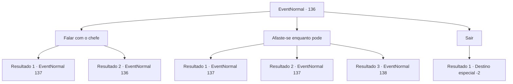

# Eventos normais · 136

[Índice da tabela](index.md) · [Índice geral](../index.md)

ID: `pt:EventNormal:136` · Fonte: `EventNormal4` · Versão: 1.2.47.

Mapeamento estático dos arquivos; a disponibilidade e a execução dependem do estado da run.

## Texto do evento

*Sem texto no arquivo.*

## Dados de entrada

```json
{
  "id": 136,
  "grade": 1,
  "place": "",
  "required": ""
}
```

## Mapa das escolhas



## Escolhas e resultados

### Escolha 1

Falar com o chefe

Requisitos e outros campos da escolha:

```json
{
  "required": "5_7_3"
}
```

#### Resultado 1.1

O homem olha para você de perto e diz para você esperar. Ele desaparece pela porta dos fundos, volta e fala com você. 

 "O chefe vai vê-lo agora. Por favor, entre, {1}."

 Você o segue para dentro para encontrar o chefe. O chefe é um homem astuto de meia-idade. Ele te olha com um sorriso. 

 "Ouvi falar de suas façanhas, aventureiro. O que o traz até nós, mendigos?"


Continuação registrada: [Evento 137](0137.md) na mesma tabela.

```json
{
  "required": "1_2_50",
  "chance": "1",
  "nextEvent": 137,
  "type": 2,
  "reward": ""
}
```

#### Resultado 1.2

Ele se recusa imediatamente. Então ele ameaça bater em você a menos que você saia.

Continuação registrada: [Evento 136](0136.md) na mesma tabela.

```json
{
  "required": "2_2_50",
  "chance": "1",
  "nextEvent": 136,
  "type": 2,
  "reward": "5_7_4"
}
```

### Escolha 2

Afaste-se enquanto pode

Requisitos e outros campos da escolha:

```json
{
  "required": ""
}
```

#### Resultado 2.1

Você franze a testa e diz a ele para se afastar. Ele fica com medo e recua. Você rapidamente passa por ele e entra na sala do chefe. O chefe para de cutucar as unhas e olha para cima. 

 "O que? Quem deixou você entrar?"


Continuação registrada: [Evento 137](0137.md) na mesma tabela.

```json
{
  "required": "20_1_4",
  "chance": "1|0_12_2",
  "nextEvent": 137,
  "type": 2,
  "reward": ""
}
```

#### Resultado 2.2

Você franze a testa e diz a ele para se afastar. Ele fica com medo e recua. Você rapidamente passa por ele e entra na sala do chefe. O chefe para de cutucar as unhas e olha para cima. 

 "O que? Quem deixou você entrar?"


Continuação registrada: [Evento 137](0137.md) na mesma tabela.

```json
{
  "required": "21_1_4",
  "chance": "1|0_12_1",
  "nextEvent": 137,
  "type": 2,
  "reward": ""
}
```

#### Resultado 2.3

Ele ignora sua ameaça. Então ele pega uma adaga e a aponta para você.

Continuação registrada: [Evento 138](0138.md) na mesma tabela.

```json
{
  "required": "",
  "chance": "15",
  "nextEvent": 138,
  "type": 2,
  "reward": "6_0_2",
  "place": 10
}
```

### Escolha 3

Sair

Requisitos e outros campos da escolha:

```json
{
  "required": ""
}
```

#### Resultado 3.1

Você se vira e vai embora.

Continuação registrada: [Destino especial `-2`](../destinos-especiais.md).

```json
{
  "required": "",
  "chance": "1",
  "nextEvent": -2,
  "type": 2,
  "reward": ""
}
```

## Referências que chegam a este evento

- [Evento 135 · escolha 1 · resultado 1](0135.md#escolha-1)
- [Evento 136 · escolha 1 · resultado 2](0136.md#escolha-1)
