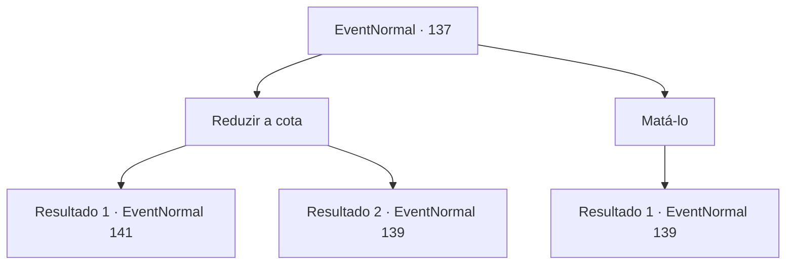

# Eventos normais · 137

[Índice da tabela](index.md) · [Índice geral](../index.md)

ID: `pt:EventNormal:137` · Fonte: `EventNormal4` · Versão: 1.2.47.

Mapeamento estático dos arquivos; a disponibilidade e a execução dependem do estado da run.

## Texto do evento

*Sem texto no arquivo.*

## Dados de entrada

```json
{
  "id": 137,
  "grade": 1,
  "place": "",
  "required": ""
}
```

## Mapa das escolhas



## Escolhas e resultados

### Escolha 1

Reduzir a cota

Requisitos e outros campos da escolha:

```json
{
  "required": ""
}
```

#### Resultado 1.1

Você pede ao patrão que reduza a cota que ele tem dos mendigos. Ele sorri e responde. 

 "Isso não é muito difícil. Eu sei que eu estava sendo um pouco duro com alguns deles... Então, qual cota você gostaria que eu cortasse?"


Continuação registrada: [Evento 141](0141.md) na mesma tabela.

```json
{
  "required": "1_2_50",
  "chance": "1",
  "nextEvent": 141,
  "type": 2,
  "reward": ""
}
```

#### Resultado 1.2

Você pede ao chefe para que reduza a cota que ele tem dos mendigos. Ele dá um sorriso torto. 

 "Olha, eu não sei de onde você é, mas fique fora do nosso negócio. Trabalhamos com nossas próprias regras. Os de fora não têm voz."

 Ele gesticula para um dos mendigos para expulsá-lo. O mendigo saca uma adaga.

Continuação registrada: [Evento 139](0139.md) na mesma tabela.

```json
{
  "required": "2_2_50",
  "chance": "1",
  "nextEvent": 139,
  "type": 2,
  "reward": "6_0_2",
  "place": 10
}
```

### Escolha 2

Matá-lo

Requisitos e outros campos da escolha:

```json
{
  "required": "2_3_0"
}
```

#### Resultado 2.1

Você decide que o chefe está melhor morto. Você saca sua arma e o mendigo ao lado do chefe saca uma adaga. A lâmina curta vem cortando o ar.

Continuação registrada: [Evento 139](0139.md) na mesma tabela.

```json
{
  "required": "",
  "chance": "1",
  "nextEvent": 139,
  "type": 2,
  "reward": "6_0_2",
  "place": 10
}
```

## Referências que chegam a este evento

- [Evento 136 · escolha 1 · resultado 1](0136.md#escolha-1)
- [Evento 136 · escolha 2 · resultado 1](0136.md#escolha-2)
- [Evento 136 · escolha 2 · resultado 2](0136.md#escolha-2)
- [Evento 138 · escolha 1 · resultado 1](0138.md#escolha-1)
