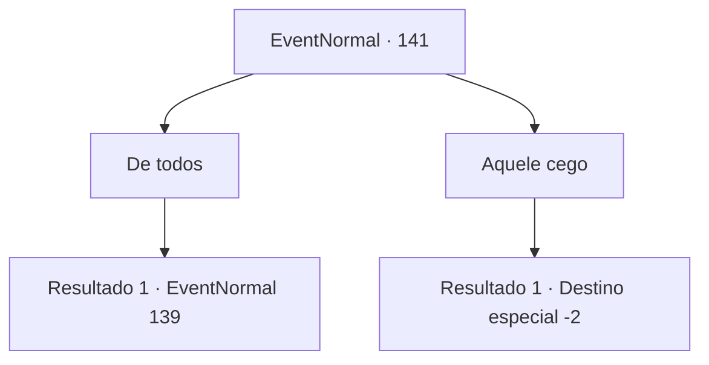

# Eventos normais · 141

[Índice da tabela](index.md) · [Índice geral](../index.md)

ID: `pt:EventNormal:141` · Fonte: `EventNormal4` · Versão: 1.2.47.

Mapeamento estático dos arquivos; a disponibilidade e a execução dependem do estado da run.

## Texto do evento

*Sem texto no arquivo.*

## Dados de entrada

```json
{
  "id": 141,
  "grade": 1,
  "place": "",
  "required": ""
}
```

## Mapa das escolhas



## Escolhas e resultados

### Escolha 1

De todos

Requisitos e outros campos da escolha:

```json
{
  "required": "1_14_12"
}
```

#### Resultado 1.1

Você lê nas entrelinhas. Se você disser a este homem quem, ele sem dúvida irá atrás do mendigo. Quando você diz a ele que quer cortar a cota de todos, o rosto do chefe escurece. Então ele aponta para você com o queixo. O guarda ao lado dele gira sua lâmina em você. 

Continuação registrada: [Evento 139](0139.md) na mesma tabela.

```json
{
  "required": "",
  "chance": "1",
  "nextEvent": 139,
  "type": 2,
  "reward": "6_0_2|5_7_5",
  "place": 10
}
```

### Escolha 2

Aquele cego

Requisitos e outros campos da escolha:

```json
{
  "required": "2_14_12"
}
```

#### Resultado 2.1

Ele acena com satisfação. 

 "Ah, sim, aquele sujeito. Tudo bem. Confesso que fui um pouco duro com ele. Vou me certificar de cortar sua cota pela metade."

 O chefe concorda de bom grado. Você volta para o mendigo falso-cego e conta a ele o que aconteceu. Ele fica pálido e grita com você. 

 "O que! Você me disse que fui eu quem disse isso?"

 Ele desamarra o curativo em volta dos olhos e sai correndo.

Continuação registrada: [Destino especial `-2`](../destinos-especiais.md).

```json
{
  "required": "",
  "chance": "1",
  "nextEvent": -2,
  "type": 2,
  "reward": "0_2_1|5_7_7|0_3_-1"
}
```

## Referências que chegam a este evento

- [Evento 137 · escolha 1 · resultado 1](0137.md#escolha-1)
