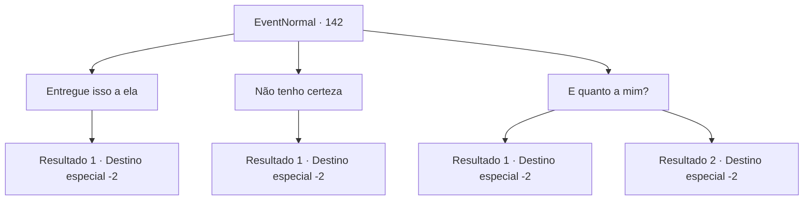

# Eventos normais · 142

[Índice da tabela](index.md) · [Índice geral](../index.md)

ID: `pt:EventNormal:142` · Fonte: `EventNormal4` · Versão: 1.2.47.

Mapeamento estático dos arquivos; a disponibilidade e a execução dependem do estado da run.

## Texto do evento

Rome, o híbrido, visita você. Ele diz que sua tática de ciúme não funcionou, e pede outras sugestões. 

## Dados de entrada

```json
{
  "id": 142,
  "grade": 1,
  "place": "",
  "required": "5_47_7|18_74_2"
}
```

## Mapa das escolhas



## Escolhas e resultados

### Escolha 1

Entregue isso a ela

Requisitos e outros campos da escolha:

```json
{
  "required": "8_46_1"
}
```

#### Resultado 1.1

Você pega um anel de prata e entrega a ele. Ele lhe dá um olhar assustado. 

 "É prata... Eu não te disse que eu era meio vampiro?"

 Ele olha para o anel por um momento antes de exclamar com realização. Ele pega o anel. Ele queima em sua carne. A fumaça sobe da palma do híbrido. 

 "Sim. Vou presenteá-la com este anel, apesar da dor. Eu só posso esperar que isso me deixe com mais do que apenas uma cicatriz... Mas eu prefiro tentar do que me afogar em meu próprio arrependimento."

 Ele agradece e vai embora.

Continuação registrada: [Destino especial `-2`](../destinos-especiais.md).

```json
{
  "required": "",
  "chance": "1",
  "nextEvent": -2,
  "type": 2,
  "reward": "4_46_1|0_2_1"
}
```

### Escolha 2

Não tenho certeza

Requisitos e outros campos da escolha:

```json
{
  "required": ""
}
```

#### Resultado 2.1

Você balança a cabeça e confessa que está sem ideias. Rome assente amargamente. 'Desculpe se eu incomodei você', ele diz, se vira e sai.

Continuação registrada: [Destino especial `-2`](../destinos-especiais.md).

```json
{
  "required": "",
  "chance": "1",
  "nextEvent": -2,
  "type": 2,
  "reward": "0_3_-1|0_2_1|5_47_9"
}
```

### Escolha 3

E quanto a mim?

Requisitos e outros campos da escolha:

```json
{
  "required": "11_0_1|24_1_1"
}
```

#### Resultado 3.1

Você pergunta a Rome o que ele pensa sobre namorar você. Ele se recusa imediatamente. 

 "Desculpe... acho que não estou pronto para seguir em frente."

 Ele se vira e sai.

Continuação registrada: [Destino especial `-2`](../destinos-especiais.md).

```json
{
  "required": "",
  "chance": "18",
  "nextEvent": -2,
  "type": 1,
  "reward": "0_2_1"
}
```

#### Resultado 3.2

Você pergunta a Rome o que ele pensa sobre namorar você. Ele te olha nos olhos por um momento, então assente. 

 "Claro... Se... você realmente não se importa."

 Ele cuidadosamente estende a mão e você a pega. Vocês dois caminham sob o luar, se conhecendo.

Continuação registrada: [Destino especial `-2`](../destinos-especiais.md).

```json
{
  "required": "",
  "chance": "1|0_12_1",
  "nextEvent": -2,
  "type": 0,
  "reward": "0_12_2|5_74_2|0_2_2"
}
```

## Referências que chegam a este evento

Nenhum `nextEvent` positivo da mesma tabela aponta para este nó. Isso não prova que seja inacessível: sorteio e estado de história podem selecioná-lo.

